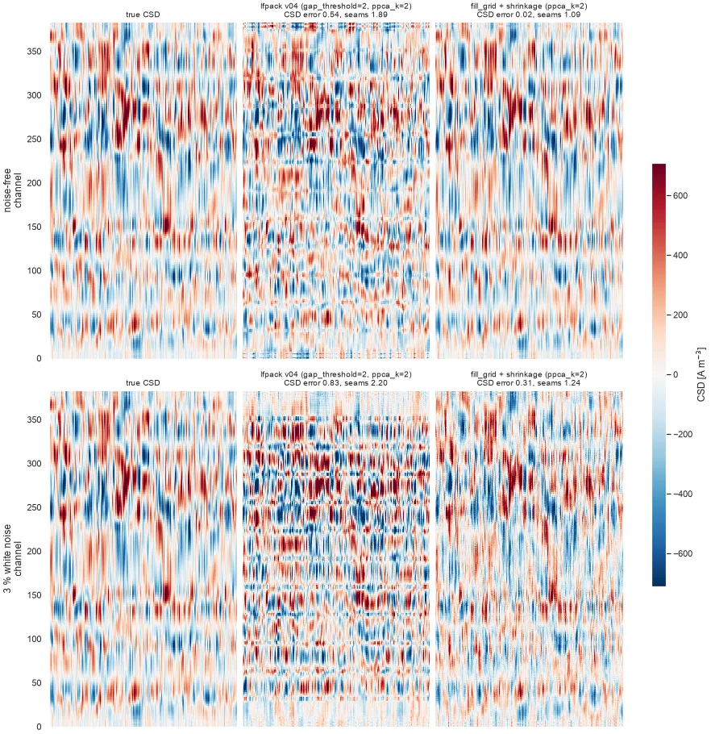
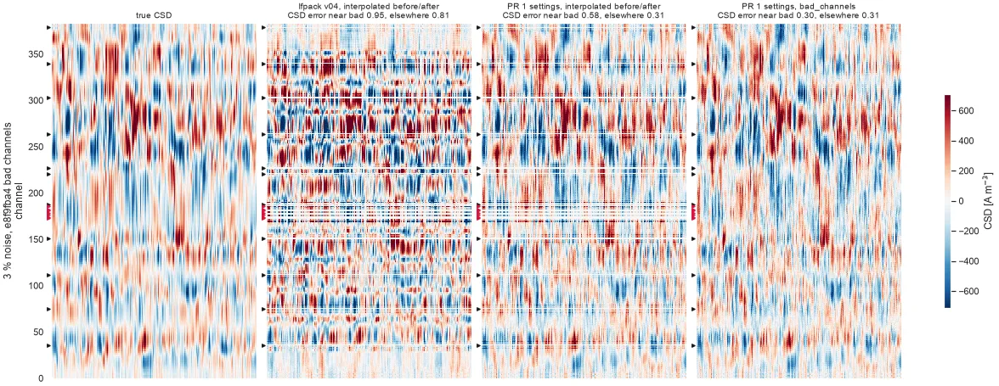

## Summary

The CSD of Cadzow-denoised LFP (ibl-neuropixel 1.13, as used by lfpack v04) had two artefacts:

- **Seams**: horizontal blocks every 32 channels, at the boundaries of Cadzow's spatial windows.
- **Bad-channel lines**: one line at each interpolated bad channel.

Both are fixed in ibl-neuropixel 1.14.0. The new settings are opt-in, and lfpack v05 uses them.

| PR | Change |
|---|---|
| [ibl-neuropixel#96](https://github.com/int-brain-lab/ibl-neuropixel/pull/96) | Removes the seams: Cadzow runs on the full probe grid, with Gavish–Donoho shrinkage instead of a hard rank cut. Entry points `cadzow_denoiser_np1` / `cadzow_denoiser_np2`. |
| [ibl-neuropixel#97](https://github.com/int-brain-lab/ibl-neuropixel/pull/97) | Removes the bad-channel lines: Cadzow estimates bad channels instead of interpolating them before and after. |
| [lfpack#22](https://github.com/int-brain-lab/lfpack/pull/22) | lfpack picks the NP1 or NP2 settings from the probe geometry. |

## Before and after

Each figure shows a 3 s snippet from one of the 11 benchmark insertions. Rows are LFP, bipolar (BPR) and CSD. Columns
are no Cadzow, Cadzow before the fix (ibl-neuropixel 1.13) and Cadzow after it (ibl-neuropixel 1.14). The brain regions are on
the right. All columns come from the production chunk worker. Each row has one colour scale, so the no-Cadzow CSD
saturates. The other 10 insertions are below as thumbnails; click any figure to browse all 11.

```{python}
#| output: asis
#| echo: false
from pathlib import Path

FEATURED = "749cb2b7"
files = sorted(Path("figures").glob("2026-10-11_cadzow_before_after_*.webp"))
print(f"![Insertion {FEATURED}: no Cadzow, Cadzow before and after the fix.]"
      f"(figures/2026-10-11_cadzow_before_after_{FEATURED}.webp){{.lightbox group=\"before-after\"}}\n")
print("::: {layout-ncol=4}")
for f in files:
    if f.stem.endswith(FEATURED):
        continue
    print(f"![{f.stem[-8:]}]({f}){{.lightbox group=\"before-after\"}}\n")
print(":::")
```

In the CSD, the "before" column shows blocks bounded by the window seams (ticks) and lines at the dead channels. The
"after" column has neither. It also keeps a little more CSD power (median 0.19 against 0.17 of the no-Cadzow CSD RMS),
at the same run time.

One artefact is left. In e8f9fba4, a band remains at channels 170–195: the neighbours of the labelled noisy channels are
noisy too (2–3.6× the noise level), but they are not labelled. That is a channel-labelling issue, not a Cadzow one.

## Why there were seams

Cadzow fits a low-rank model in windows of 64 channels, blended every 32 channels. The CSD is a second spatial
derivative, so any disagreement between two neighbouring window fits shows up as a seam. The fits disagreed for two
reasons:

1. **NP1 checkerboard.** Each NP1 row holds only 2 of the 4 lateral positions. Half of Cadzow's trajectory matrix was
   zeros, and the SVD treated them as data. The fix fills the empty positions from their neighbours.
2. **Hard adaptive rank.** Neighbouring windows kept different numbers of components. The fix shrinks the singular
   values smoothly (Gavish–Donoho) instead of cutting them.

Bad channels were interpolated before and after Cadzow. An interpolated channel does not follow the local curvature
that the CSD measures, so it leaves a line. The fix treats bad channels like the empty grid positions, so that Cadzow
estimates them.

## Validation on a synthetic field

The synthetic field has 40 laminar current sources forward-modelled onto NP1, with 3 % white noise. Its true CSD is
known. The bad channels are those of e8f9fba4 (11 dead, 7 noisy).

```{python}
#| label: tbl-synthetic
#| tbl-cap: "Synthetic field, 3 % noise. CSD error: median per-channel RMS error against the true CSD, relative to the true CSD RMS, near bad channels and elsewhere. Seam ratio: error within ±2 channels of a window boundary over the error elsewhere; 1 means no seams."
#| echo: false
import pandas as pd

b = pd.read_csv("2026-10-10_cadzow_synthetic_bad.csv").set_index("method")
b = b.loc[["production", "shrink, interpolated", "shrink, bad as missing"]]
b.index = ["ibl-neuropixel 1.13", "#96: full grid + shrinkage", "#96 + #97: bad channels estimated"]
b = b[["csd_err_elsewhere", "csd_err_near_bad", "seam_ratio"]]
b.columns = ["CSD error", "CSD error near bad channels", "seam ratio"]
b.round(2)
```

Without bad channels, the CSD error is 0.29, the same as with #97. The PR figures show the synthetic field.

::: {layout-ncol=2}
{#fig-pr96 .lightbox}

{#fig-pr97 .lightbox}
:::

## Compatibility

- With its defaults, `cadzow_denoiser` gives the same output as in 1.13.0, bit for bit.
- The shrinkage scale was calibrated on white noise: 2.25 for NP1 and 1.22 for NP2. The NP1 value brings the seams back
  on NP2, hence the two entry points.
- Multi-shank probes are not supported yet by the full-grid option.
- In lfpack v05, file sizes per tier do not change. Fidelity to the denoised input is about 2 dB lower, and the codec,
  not Cadzow, now limits the CSD. See [lfpack v05](../2026-10-lfpack-v05/index.qmd).

::: {.callout-note collapse="true"}
## Code, data and earlier attempts

| File | Content |
|---|---|
| `plot_before_after.py` | Before / after figures on this page |
| `cadzow_synthetic*.py`, `cadzow_fill.py`, `cadzow_shrink*.py` | Synthetic field, full-grid fill, shrinkage prototypes |
| `cadzow_bad_real.py`, `cadzow_synthetic_bad.py` | Bad channels as missing grid positions |
| `cadzow_pr_figures.py` | PR figures, with the ibldsp API |

The cached chunks are in `~/scratch/lfp/csd_lfpack_v04/`, made by `../2026-10-csd/plot_cadzow_csd.py`.

Before the synthetic field, three remedies changed the blending of the windows: staggered runs
(`cadzow_stagger.py`), cycle spinning (`cadzow_cycle_spin.py`) and more overlap (`ovx = 48`). None of them removed the
seams, because the fits themselves disagreed. MSSA (`cadzow_mssa_real.py`) denoised too little.
:::
