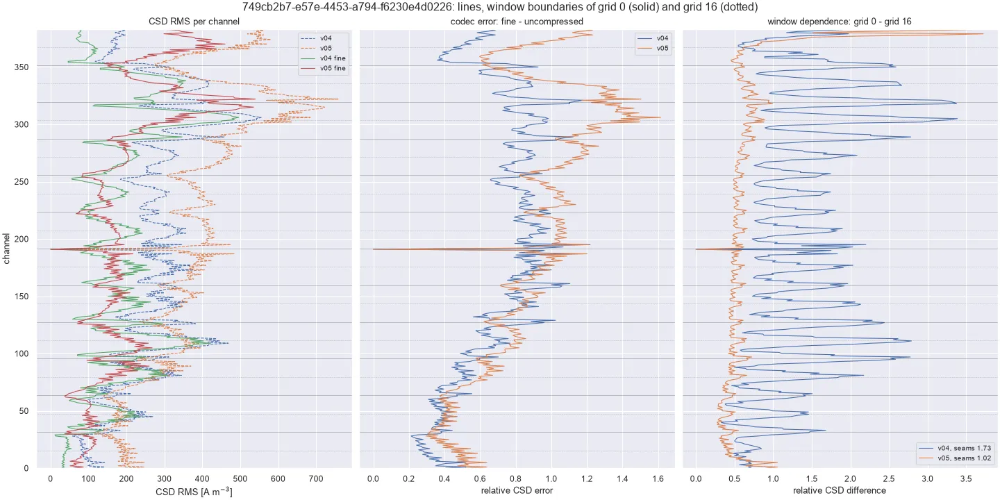
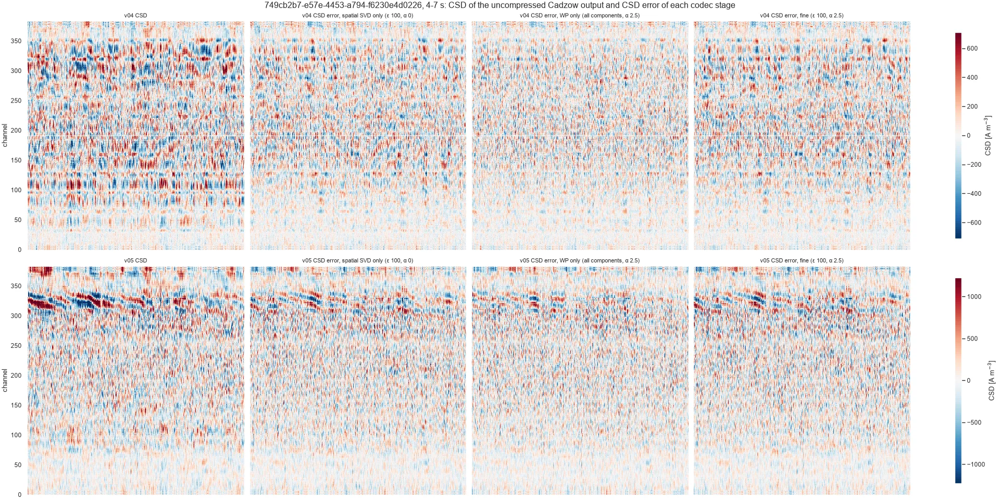

## Summary

lfpack v05 changes only the denoising stage of [lfpack v04](../2026-06-lfp-compression-svd/index.qmd). Cadzow had
left seams in the CSD at its window boundaries; the fix and its diagnosis are in
[Cadzow window seams](../2026-10-cadzow-seams/index.qmd).

| | v04 | v05 |
|---|---|---|
| Cadzow | hard adaptive rank on the channel trajectory (`gap_threshold=2`) | full grid + Gavish–Donoho shrinkage (`cadzow_denoiser_np1`, NP2: `cadzow_denoiser_np2`) |
| Bad channels | interpolated before and after Cadzow | estimated by Cadzow (`bad_channels_as_missing`) |
| Codec | ε = 100, shared basis of 32, α = 14 / 7 / 2.5 | unchanged |
| Code | ibl-neuropixel 1.13, lfpack 1.0 | ibl-neuropixel 1.14.0 ([#96](https://github.com/int-brain-lab/ibl-neuropixel/pull/96), [#97](https://github.com/int-brain-lab/ibl-neuropixel/pull/97)), [lfpack#22](https://github.com/int-brain-lab/lfpack/pull/22) |

On the 11 benchmark insertions:

- **Seams.** Cadzow no longer depends on where its windows are.
- **Bad-channel lines** in the CSD halve.
- **File sizes** per tier move by −5 % to +5 % (median).
- **Fidelity.** Reconstruction SNR against the denoised input drops by about 2 dB, because v05 keeps more 10–100 Hz
  content.

The fine tier removes much of the CSD of both versions. On the calibrated synthetic field, it raises the v05 CSD
error from 0.31 to 0.41. That is still well below v04 even before compression (0.82).

All runs use the 32.8 s mid-recording chunks of the production chunk worker without Cadzow (0.5 Hz high-pass,
bad-channel interpolation, CAR, decimation to 250 Hz, saturation mute). Each Cadzow output is compressed chunk by chunk
with `lfpack.compress_to_h5`. The v04 archive itself was compressed over the whole recording and gives a different
encoding of the same samples (22.2 against 26.6 dB on 1a276285), so it is not used: no v05 archive exists yet.

## Benchmark insertions

Columns:

- uncompressed: production worker output, no Cadzow;
- the uncompressed v05 Cadzow output: the input of v05;
- lfpack v04 fine;
- lfpack v05 fine.

Brain regions are on the left, with dead (black) and noisy (red) channels. Each row has one colour scale, from v04
fine. Stars mark the Cadzow window boundaries. Click a figure to browse all 11 insertions.

```{python}
#| output: asis
#| echo: false
import pandas as pd

c = pd.read_csv("2026-10-10_cadzow_compression.csv")
for pid in sorted(c.pid.str[:8].unique()):
    print(f""
          f"{{#fig-fine-{pid} .lightbox group=\"fine\"}}\n")
```

## Compression

Size is the HDF5 file size. SNR is the reconstruction against its own denoised input; CSD SNR is the same for the CSD.
"Size at equal SNR" interpolates the v05 size at the v04 SNR between v05 runs at several α (`n` insertions within
range).

```{python}
#| label: tbl-compression
#| tbl-cap: "lfpack tiers, v04 against v05: compression ratio, size ratio v05 / v04 (median, min–max over insertions), reconstruction SNR against the denoised input (medians), and size ratio at equal SNR."
#| echo: false
TIERS = {"small": 14.0, "default": 7.0, "fine": 2.5}  # alpha of the lfpack v04 tiers
c = c[c.tier.isin(TIERS)]
piv = c.pivot_table(index="pid", columns=["tier", "method"], values="size_kb")
eq = pd.read_csv("2026-10-10_cadzow_compression_equal_snr.csv", index_col="pid")
med = c.groupby(["tier", "method"])[["cr", "snr_db", "csd_snr_db"]].median()
rows = []
for t in TIERS:
    q = piv[(t, "after")] / piv[(t, "before")]
    rows.append({
        "tier": f"{t} (α = {TIERS[t]})",
        "CR v04": med.loc[(t, "before"), "cr"], "CR v05": med.loc[(t, "after"), "cr"],
        "size v05 / v04": f"{q.median():.2f} ({q.min():.2f}–{q.max():.2f})",
        "SNR v04 [dB]": med.loc[(t, "before"), "snr_db"], "SNR v05 [dB]": med.loc[(t, "after"), "snr_db"],
        "CSD SNR v04 [dB]": med.loc[(t, "before"), "csd_snr_db"],
        "CSD SNR v05 [dB]": med.loc[(t, "after"), "csd_snr_db"],
        "size at equal SNR": f"{eq[t].median():.2f} (n = {eq[t].notna().sum()})",
    })
pd.DataFrame(rows).set_index("tier").round(1)
```

- **Size is stable per tier.** The fine tier is 5 % larger (median, −12 % to +29 %), the default tier 2 % smaller and
  the small tier 5 % smaller. At the fine tier, 1a276285, 1e104bf4, 6638cfb3, 749cb2b7 and dab512bd get smaller files.
- **Fidelity drops by about 2 dB at the same tier:** 22.8 against 25.0 dB at the fine tier. The extra error sits in
  10–100 Hz, the content the v04 hard rank removed.
- **At equal SNR**, v05 files are 6 % (small) to 13 % (default) larger. The fine-tier estimate (1.21) only covers the
  6 insertions whose v04 SNR v05 reaches by lowering α alone.
- **The fine tier removes much of the CSD.** The median CSD kept, relative to the no-Cadzow signal, goes from 0.169 to
  0.109 for v04 and from 0.194 to 0.115 for v05. v05 fine keeps more than v04 fine in 8 of the 11 insertions.

## Seams and bad-channel lines

There is no ground truth on real data, so two checks stand in for the synthetic metrics:

- **Window dependence** (`cadzow_window_dependence.py`). Cadzow is run a second time with its window grid offset by
  16 channels. Where the fit depends on the window, the two runs differ, most at the boundaries of either grid. A
  seam ratio (period 16) of 1 means no seams.
- **Bad-channel lines** (`cadzow_bad_lines.py`). For each bad channel, the CSD RMS of the channels whose CSD involves
  it (same column, ≤ 2 rows) is compared with the same-column channels 3 to 6 rows away, as |log ratio|. 0 means no
  line.

```{python}
#| label: tbl-window-dependence
#| tbl-cap: "Window dependence (median per-channel CSD difference between two window grids, relative to the CSD RMS) and its seam ratio, v04 against v05 Cadzow."
#| echo: false
pd.read_csv("2026-10-10_cadzow_window_dependence.csv", index_col="pid").round(2)
```

v05 depends less than half as much on where its windows are, and its difference has no peak at the boundaries (seam
ratio 0.99 against 1.30). The profiles of 749cb2b7 (@fig-dependence) show the v04 peaks every 16 channels, against a
flat v05.

{#fig-dependence .lightbox}

```{python}
#| label: tbl-bad-lines
#| tbl-cap: "Bad-channel line index (median over bad channels of |log| CSD RMS near / far in the same column; 0 = no line), uncompressed and fine-compressed."
#| echo: false
pd.read_csv("2026-10-10_cadzow_bad_lines.csv", index_col="pid").round(2)
```

With the bad channels left to Cadzow, the lines halve (median 0.40 → 0.19 at the fine tier; 749cb2b7 0.64 → 0.10).
Three insertions are not fixed:

- **dab512bd** is about 1.1 in both versions, so its line does not come from the interpolation.
- **eebcaf65** does not improve.
- **e8f9fba4** gets worse at the fine tier (0.40 → 0.62): the noisy band at channels 170–195, whose neighbours are not
  labelled.

## The codec and the CSD

The fine tier leaves horizontal lines in the CSD of both versions. They are not Cadzow seams. The codec has two lossy
stages: a per-chunk spatial SVD truncated at ε × its noise floor, and wavelet-packet thresholding of each component's
time course (α). Both drop the low-variance spatial components. That is where the curvature measured by the CSD lives,
and both stages judge it by voltage error. Each 8 s chunk is then rebuilt from a few fixed spatial profiles, whose
curvature stays at one depth for the whole chunk.

On 749cb2b7 (@fig-codec), either stage alone takes the CSD SNR of v05 to about 2 dB (`cadzow_codec_lines.py`). In
the error images, the strong sink/source pattern at channels 300–340 is attenuated by about half.

{#fig-codec .lightbox}

```{python}
#| label: tbl-codec-stages
#| tbl-cap: "749cb2b7: size, voltage SNR and CSD SNR of each codec stage."
#| echo: false
pd.read_csv("2026-10-10_cadzow_codec_lines_749cb2b7.csv").drop(columns="low_share").set_index(["input", "stage"]).round(1)
```

**Codec settings** (`cadzow_codec_csd_sweep.py`). Loosening ε and α raises the CSD SNR only slowly, and the voltage SNR
stops at 32 dB, which is set by the 32-vector shared basis:

- With a 96-vector basis, ε = 3 and α = 0.3, it reaches 40 dB, with a CSD SNR of 8.8 dB (15.9 dB after 40 µm depth
  smoothing), at a compression ratio of 8.
- Spatial pre-emphasis before compression (Z = (I − κL)X, L the second difference along each column;
  `cadzow_codec_preemphasis.py`) doubles the CSD SNR of the fine tier (1.5 → 3.3 dB at κ = 3) for 30 % more size.

```{python}
#| label: tbl-sweep
#| tbl-cap: "749cb2b7, v05: CSD fidelity against epsilon and alpha (shared basis of 32)."
#| echo: false
pd.read_csv("2026-10-10_cadzow_codec_csd_sweep_749cb2b7.csv").set_index(["epsilon", "alpha"]).round(1)
```

**Signal or noise?** CSD SNR against the codec's own input penalises the codec for every bit of noise it removes. On
the real chunks, the uncompressed CSD is dominated by small-amplitude, noise-like depth texture. The calibrated
synthetic field has a known CSD (`cadzow_synthetic_codec.py`; @tbl-synthetic-codec):

```{python}
#| label: tbl-synthetic-codec
#| tbl-cap: "Synthetic field: CSD error against the true CSD and seam ratio, through Cadzow and the lfpack tiers."
#| echo: false
s = pd.read_csv("2026-10-10_cadzow_synthetic_codec.csv")
t = s.pivot_table(index=["noise", "cadzow"], columns="tier", values=["csd_err", "seam_ratio"])
t = t.reindex(columns=["uncompressed", "fine", "default"], level=1)
t.round(2)
```

- **At 3 % noise**, the fine tier raises the v05 CSD error from 0.31 to 0.41, and adds no seams.
- **v04 is worse at every tier.** Compression even slightly lowers v04's error and seams, from 0.82 to 0.72.
- **Most of what the codec removes from the real chunks is noise,** but it also loses some real CSD.

Caveats:

- The synthetic sources are laminar, which suits a fixed spatial basis; real data may lose more.
- On the noise-free field, the fine tier leaves a CSD error of 0.72, more than at 3 % noise. This is unexplained, and
  hints that the codec's threshold relative to its noise floor misbehaves on very clean input.

For CSD analyses on the archives, expect about a third more CSD error than on uncompressed v05. Fine-scale features at
one depth that persist over a chunk need checking against the uncompressed data. For voltage and decoding work the
difference is small. Real CSD fidelity would need a codec criterion that weights error by spatial curvature.

## Code and data

| File | Content |
|---|---|
| `cadzow_compression.py` | lfpack tiers, v04 against v05, on the 11 chunks; equal-SNR sizes |
| `cadzow_compression_figures.py` | Benchmark figures (uncompressed, v05 Cadzow, v04 fine, v05 fine) |
| `cadzow_window_dependence.py` | Window dependence, grid offset by 16 |
| `cadzow_bad_lines.py` | Bad-channel line index |
| `cadzow_codec_lines.py` | CSD error per codec stage |
| `cadzow_codec_csd_sweep.py` | CSD fidelity against ε, α |
| `cadzow_codec_preemphasis.py` | Spatial pre-emphasis feasibility |
| `cadzow_synthetic_codec.py` | Synthetic field through Cadzow and the codec |

The scripts import the helpers of `../2026-10-cadzow-seams/` and read the production chunks cached in
`~/scratch/lfp/csd_lfpack_v04/` by `../2026-10-csd/plot_cadzow_csd.py`.
