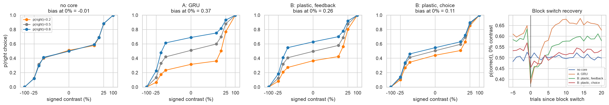
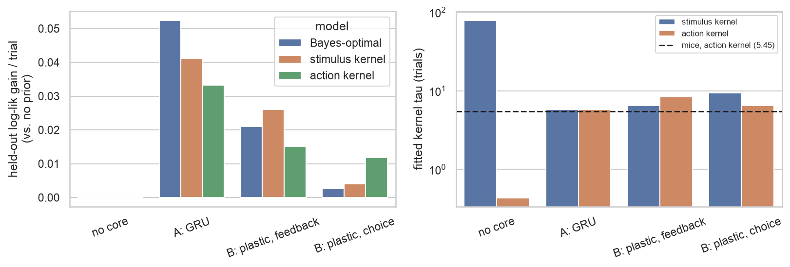
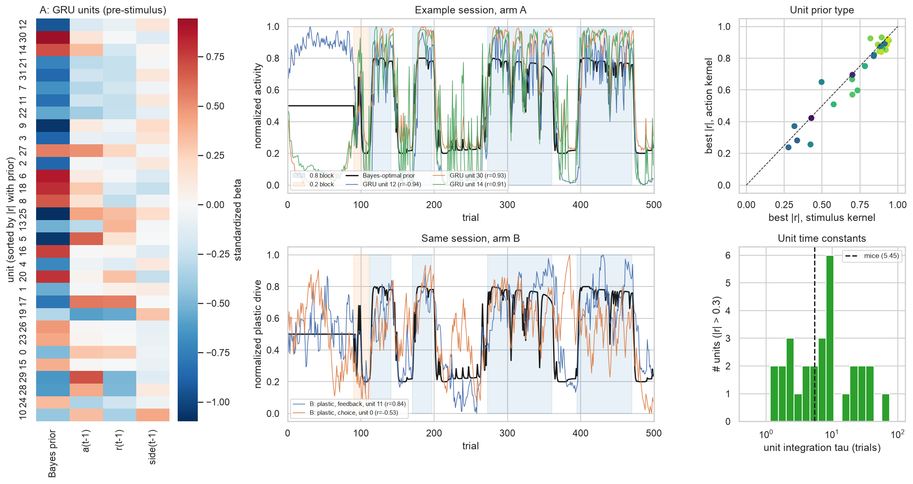
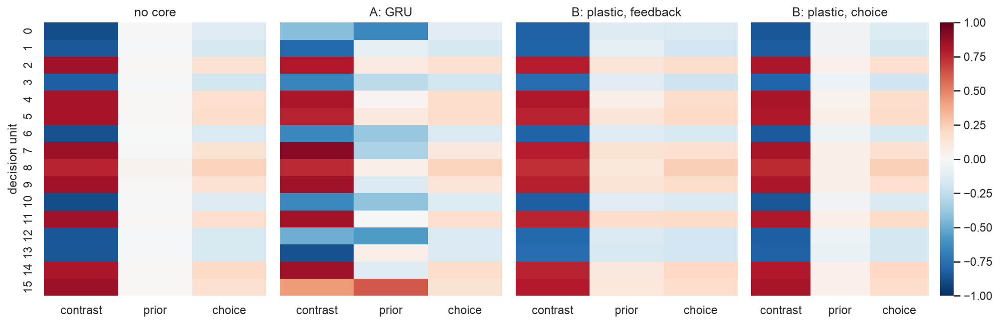
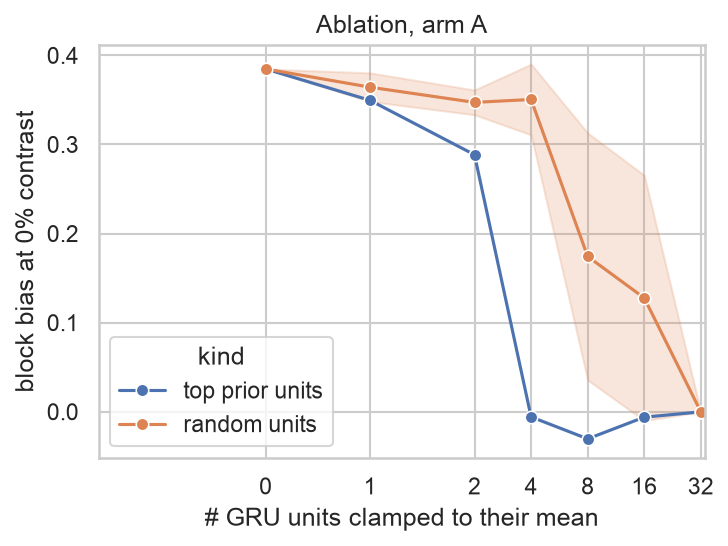
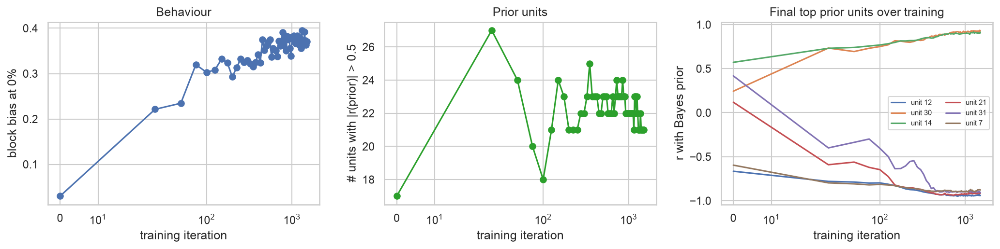
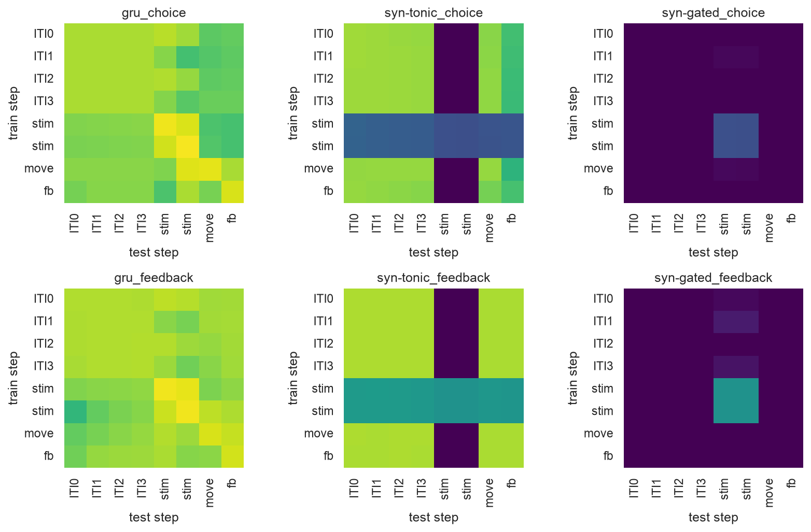
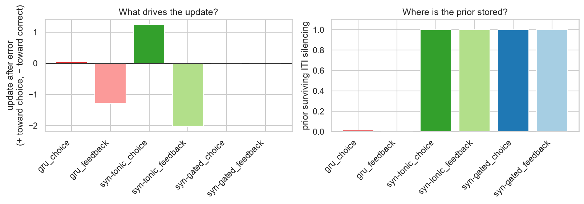

## Original question

Build a small neural network that solves the IBL task, pre-train it, then leave a few layers loose during the biased task, and observe how single neurons build prior expectations in the skewed blocks.

## Introduction

Mice in the International Brain Laboratory (IBL) task use the block prior: on zero-contrast trials they choose the side favoured by the current block, and they recover within about 5 trials after an uncued switch. Findling et al. (Brain-wide representations of prior information) found that most mice estimate an **action-kernel prior**, an exponentially weighted average of their own past choices with a median time constant of 5.45 trials, rather than the Bayes-optimal prior. They also found that the prior is decodable across much of the brain (Brain-Wide Map, BWM). Schaeffer et al. (2020) reverse-engineered recurrent neural networks (RNNs, defined in Methods) trained on this task at the population level. Here we take the single-unit stance of Cammarata ("Neural networks are already clean", Goodfire): look at the units directly, ablate them, and watch them form during training.

## Methods

**Task** (`task.py`). The generative process follows the prior paper:

- 90 unbiased trials, then blocks with p(right) = 0.2 or 0.8. Block lengths are drawn from an exponential distribution with τ = 60, truncated to [20, 100] trials.
- Contrasts are drawn uniformly from {0, 6.25, 12.5, 25, 100}%.
- Sensory input is 8 noisy samples per side (σ = 0.28 per sample).

The Bayes-optimal prior is computed by forward filtering a hidden semi-Markov model over (block type, run length). Stimulus- and action-kernel priors are exponential averages of past sides or past choices.

**Glossary.**

| term | meaning |
|---|---|
| IBL | International Brain Laboratory |
| BWM | Brain-Wide Map, the IBL paper mapping neural activity across the mouse brain during the task |
| MLP | multi-layer perceptron: a feedforward network of stacked layers, each a weighted sum of its inputs followed by a nonlinearity |
| ReLU | rectified linear unit, the nonlinearity max(0, x) |
| tanh | hyperbolic tangent, a nonlinearity that squashes its input into (−1, 1) |
| logit | log-odds log(p / (1 − p)); the sigmoid σ(logit) = 1 / (1 + e^−logit) turns it back into a probability |
| RNN | recurrent neural network: a network whose units feed back onto themselves, so its state at one step depends on its state at the previous step. That state is a form of memory |
| GRU | gated recurrent unit, a standard RNN type whose learned "gates" decide, at each step, how much of the old state to keep and how much to overwrite with new input |
| BPTT | backpropagation through time: gradient training of an RNN by unrolling it over the whole sequence (here, a 500-trial session) and backpropagating the error through every step |
| SGD | stochastic gradient descent: change each weight a little in the direction that reduces the error on the current example |
| Hebbian rule | a weight change driven by activity alone ("cells that fire together wire together"), with no error signal |
| HSMM | hidden semi-Markov model: a hidden state (here, the current block) whose duration follows an explicit distribution |

**One trial, inputs and outputs.** The network processes one trial per step.

- **Input on trial t:** a vector x_t of 16 numbers: 8 noisy samples of the left-screen contrast, then 8 of the right-screen contrast.
- **Output on trial t:** a probability p_t of choosing right. The choice a_t (+1 right, −1 left) is drawn from p_t.
- **The environment then returns** a reward r_t: +1 if a_t matches the stimulus side, −1 otherwise.

The block p(right) is never given as an input. The network can only infer it from the history of its choices and rewards, and it carries that inference to the next trial through the core.

**Modules** (`models.py`). Frozen modules are the same in both arms. The core is the "loose" part.

| module | input | output | parameters | trained in |
|---|---|---|---|---|
| front-end (MLP 16 → 32 → 16, ReLU then tanh) | retinal samples x_t (16) | evidence code z_t (16) | weights | phase 1, then frozen |
| decision layer | z_t (16) and core drive u_t (16) | decision units d_t = tanh(W z_t + b + u_t) (16) | W, b | phase 1, then frozen |
| readout | d_t (16) | logit_t = w_o · d_t, p_t = σ(logit_t) | w_o | phase 1, then frozen |
| **core A**: GRU, 32 units | after trial t: z_t, a_t, r_t (18); its own state h_{t−1} (32) | state h_t (32); drive u_{t+1} = W_u h_t (16) | GRU weights, W_u | phase 2 (BPTT) |
| **core B**: plastic synapses P (16 × 8) | fixed context activity g (8); after trial t: the error or choice signal | drive u_t = P_t g (16) | only η (learning rate) and λ (decay) | phase 2 (meta-learning of η, λ) |

**Arm A: the prior is held in recurrent activity.** The GRU state h is the network's memory between trials. After each trial, it reads what happened (evidence code, choice, reward) and updates h. Before the next stimulus, h sets a drive u onto the decision units that biases them toward one side. The GRU weights are trained with BPTT over 500-trial sessions (1,500 iterations of 32 sessions). They are fixed during a test session, so all trial-to-trial adaptation happens in the activity h.

```{mermaid}
%%| label: fig-arch-a
%%| fig-cap: "Arm A. Grey: pre-trained and frozen. Orange: loose (trained in phase 2). Dashed: carried to the next trial."
flowchart LR
  x["x_t: retinal samples<br/>(8 left + 8 right)"] --> fe["front-end MLP<br/>16 → 32 → 16"]
  fe -- "z_t (16)" --> dec["decision layer<br/>d_t = tanh(W z_t + b + u_t)"]
  dec -- "d_t (16)" --> ro["readout<br/>p_t = σ(w_o · d_t)"]
  ro --> act["choice a_t ∼ p_t"]
  act --> env["environment<br/>reward r_t = ±1"]
  gru["GRU core<br/>state h (32 units)"] -- "u_t = W_u h_{t−1}" --> dec
  fe -. "z_t" .-> gru
  act -. "a_t" .-> gru
  env -. "r_t" .-> gru
  gru -. "h_t → next trial" .-> gru
  classDef frozen fill:#e6e6e6,stroke:#888,color:#222
  classDef loose fill:#ffd8a8,stroke:#e8590c,color:#222
  class fe,dec,ro frozen
  class gru loose
```

**Arm B: the prior is held in synaptic weights.** There is no recurrence. A fixed population of 8 context units with constant activity g projects onto the 16 decision units through plastic synapses P. Their drive is u_t = P_t g. After each trial, P changes:

P_{t+1} = (1 − λ) P_t + η δ_t gᵀ

- λ makes the synapses decay back toward zero, so old trials are forgotten.
- η is the learning rate.
- δ_t is a vector (16) with one entry per decision unit, and it depends on the rule. Both rules use e = w_o ⊙ (1 − d_t²), the sensitivity of the output logit to each decision unit's input:
  - **feedback rule:** δ_t = (y_t − p_t) e, where y_t = 1 if the stimulus was right and 0 otherwise. This is online SGD of this one layer on the task error after feedback: the synapses learn from prediction errors.
  - **choice rule:** δ_t = a_t e. This is a Hebbian rule, with no error term: the synapses strengthen toward whatever the network just chose, which implements an action kernel.

Only η and λ (2 numbers) are tuned in phase 2, by meta-learning. The trial-to-trial adaptation inside a session is in P.

```{mermaid}
%%| label: fig-arch-b
%%| fig-cap: "Arm B. Grey: pre-trained and frozen. Orange: plastic synapses, updated online after every trial. Dashed: signals that drive the synaptic update."
flowchart LR
  x["x_t: retinal samples<br/>(8 left + 8 right)"] --> fe["front-end MLP<br/>16 → 32 → 16"]
  fe -- "z_t (16)" --> dec["decision layer<br/>d_t = tanh(W z_t + b + u_t)"]
  dec -- "d_t (16)" --> ro["readout<br/>p_t = σ(w_o · d_t)"]
  ro --> act["choice a_t ∼ p_t"]
  act --> env["environment<br/>reward / true side"]
  ctx["context units<br/>g (8, constant)"] --> P["plastic synapses P<br/>(16 × 8)"]
  P -- "u_t = P_t g" --> dec
  env -. "feedback rule: y_t − p_t" .-> P
  act -. "choice rule: a_t" .-> P
  classDef frozen fill:#e6e6e6,stroke:#888,color:#222
  classDef loose fill:#ffd8a8,stroke:#e8590c,color:#222
  class fe,dec,ro,ctx frozen
  class P loose
```

**Training phases.**

- **Phase 1 (pre-training):** front-end, decision layer and readout are trained on single unbiased trials (p(right) = 0.5) with no core (u = 0). The loss is the cross-entropy between p_t and the true side. These modules are then frozen.
- **Phase 2:** only the core learns, on full biased sessions, with the same loss. Choices are sampled from p_t and fed back to the core.

A "unit" in the single-unit analyses means:

- in arm A, one of the 32 GRU state values h, read just before the stimulus;
- in arm B, the plastic drive u onto one of the 16 decision units.

**Analysis** (`analysis.py`). There are 200 held-out evaluation sessions.

- **Behaviour:** block bias = p(right | 0%, 0.8 block) − p(right | 0%, 0.2 block), computed from the policy.
- **Prior-model comparison:** a logistic choice model on signed contrast plus logit(prior). Kernel τ is selected on half of the sessions, and the held-out log-likelihood gain over a no-prior model is reported on the other half.
- **Units:**
  - standardized regression of pre-stimulus unit activity on the Bayes prior, a(t−1), r(t−1) and side(t−1);
  - the best-matching kernel τ for each unit;
  - clamping ablations;
  - tracking across checkpoints.

## Results

### Behaviour

| agent | accuracy (biased trials) | block bias at 0% |
|---|---|---|
| no core (pre-trained only) | 0.732 | −0.01 |
| A: GRU | 0.790 | 0.37 |
| B: plastic, feedback | 0.773 | 0.26 |
| B: plastic, choice | 0.748 | 0.11 |

Both arms shift their psychometric curves in the direction of the block (@fig-behaviour). The GRU learns the strongest prior and recovers after a switch within about 5 trials. The feedback rule's shift is smaller; the Hebbian choice rule's is smallest.

{#fig-behaviour}

### Which prior does each network use?

| agent | best model | Bayes gain | stim. kernel gain (τ) | action kernel gain (τ) |
|---|---|---|---|---|
| A: GRU | Bayes-optimal | 0.053 | 0.041 (5.8) | 0.033 (5.8) |
| B: plastic, feedback | stimulus kernel | 0.021 | 0.026 (6.5) | 0.015 (8.4) |
| B: plastic, choice | action kernel | 0.003 | 0.004 (9.4) | 0.012 (6.5) |

Gains are held-out log-likelihood per trial relative to the no-prior model.

- **Arm A** comes closest to the Bayes-optimal prior.
- **Feedback rule** behaves as a stimulus kernel.
- **Choice rule** reproduces the mouse strategy: it is fit best by the action kernel, with τ = 6.5 trials, and its meta-learned decay is 6.1 trials. The mouse median is 5.45. This mouse-like strategy also gives the weakest bias of the three arms.

{#fig-models}

### Single units

**Arm A.** In the GRU, 21 of 32 units correlate with the Bayes prior at |r| > 0.5 (@fig-units).

- Units come in both polarities: e.g. unit 12 at r = −0.94, units 30 and 14 at r = +0.93 and +0.91.
- Most units are best described by a **stimulus** kernel rather than an action kernel (27 of 32). This is consistent with the core seeing a(t−1) and r(t−1), from which the true side follows.
- A minority of units mix the prior with the last action or reward (e.g. units 5, 17, 29).
- Unit integration time constants range from 1 to 60 trials, with a median of 7.4 trials. The population therefore spans the mouse τ rather than matching it in a single unit.
- Some units also carry a context code: unit 12 is high throughout the unbiased segment and switches to tracking the prior at trial 90.

**Arm B.** The plastic drive tracks the block more noisily, especially under the choice rule. That rule reinforces its own errors, so the drive drifts within blocks.

{#fig-units}

**Decision layer** (@fig-decision). The GRU concentrates its drive on a few decision units: 0, 12 and 15 become prior-dominated, with weaker contrast tuning. In arm B, the plastic drive is spread weakly across all decision units along the readout direction. These are two qualitatively different single-unit signatures of the same behaviour.

{#fig-decision}

### Ablation and emergence

Clamping the top 4 prior units of the GRU to their mean abolishes the block bias (0.385 → −0.006), whereas 4 random units leave it almost intact (0.350 ± 0.040) (@fig-ablation). Random ablations of 8 or more units start hurting too (0.17 ± 0.14), because prior units make up two thirds of the population.

{#fig-ablation}

Over training (@fig-emergence), the untrained GRU already has 17 units with |r(prior)| > 0.5 but no behavioural bias (0.03). Random recurrence over choice and reward inputs integrates history for free, so what training adds is mostly the readout of that signal. The bias rises within the first ~100 iterations. The final top prior units sharpen gradually, e.g. unit 31 going from r = +0.42 to −0.9, which is a polarity flip.

{#fig-emergence}

### Within-trial time: can the hypotheses be told apart?

**Setup** (`models_time.py`, `train_time.py`, `analysis_time.py`):
- Each trial is unrolled into 8 steps of about 100 ms: 4 inter-trial interval (ITI) steps, 2 stimulus steps (the choice is read at the end of the second), 1 movement step and 1 feedback step. Every step adds activity noise.
- The models cross two factors:
  - **Storage:** recurrent activity (GRU), or plastic synapses. The synapses come from a context population that is either always active (*tonic*) or active only during the stimulus (*gated*, which makes the prior activity-silent).
  - **Update driver:** the network's own choice (given at the movement step), or the correct side (given at the feedback step).
- The analyses are BWM-style. They are run on the recorded units: core plus decision units for the GRU, and decision units only for the synaptic models.

| | GRU choice | GRU feedback | syn. tonic choice | syn. tonic feedback | syn. gated choice | syn. gated feedback |
|---|---|---|---|---|---|---|
| block bias | 0.25 | 0.32 | 0.09 | 0.27 | 0.09 | 0.27 |
| best prior model (τ) | action (5.8) | Bayes | action (6.5) | stimulus | action (6.5) | stimulus |
| R² prior, last ITI step | 0.87 | 0.88 | 0.85 | 0.88 | 0.00 | 0.00 |
| neural update after error (+ choice / − correct) | +0.04 | −1.29 | +1.24 | −2.03 | n/a | n/a |
| prior × contrast / prior (decision units) | 0.13 | 0.09 | 0.15 | 0.13 | 0.15 | 0.13 |
| prior surviving ITI silencing (same trial / +3) | 0.02 / 0.44 | 0.00 / 0.62 | 1 / 1 | 1 / 1 | 1 / 1 | 1 / 1 |

: Signatures per model (`models/time/signatures.csv`). {#tbl-signatures}

**Update driver: separable.** After an error, the prior decoded from ITI activity moves toward the chosen side when the update is driven by the choice, and toward the correct side when it is driven by feedback (@fig-drive-storage, left). This neural readout matches the behavioural one. The GRU given its choice is an intermediate case (+0.04): it also sees the stimulus, so it can infer its own errors from strong stimuli.

**Storage: not separable from correlational signatures, except for activity-silent storage.**
- The GRU and the tonic synapses look the same on ITI decodability (@fig-time-decoding), on cross-temporal generalisation (@fig-crosstemporal), and on update direction.
- Offset vs gain does not discriminate either: all models add the prior as an offset, and the small interaction comes from tanh saturation. That test would instead tell which synapses are plastic (context vs stimulus pathway).
- Only gated synapses stand out, because the prior is invisible during the ITI. The BWM finds the prior decodable before the stimulus in many regions, so purely activity-silent storage is already unlikely.
- Behaviour cannot separate tonic from gated synapses at all: their choices are identical.

**The discriminating test is causal.** Silencing activity during one ITI erases the GRU's prior, which then rebuilds over the next trials. It leaves the synaptic prior untouched (@fig-drive-storage, right). The BWM has no perturbations, so this test needs an optogenetic ITI silencing experiment in the biased task.

{#fig-time-decoding}

{#fig-crosstemporal}

{#fig-drive-storage}

## Discussion

- **Where the prior lives sets the strategy.** A recurrent core trained end-to-end approaches the Bayes-optimal prior. An online prediction-error rule acts as a stimulus kernel. A Hebbian rule on one's own choices acts as an action kernel with a mouse-like time constant. If mice use an action kernel, this suggests a choice-driven, plasticity-like mechanism rather than an optimally trained recurrent integrator. However, a recurrent network given only its own choices would also produce an action kernel. The question therefore splits in two: what drives the update (the prior paper's neural analyses already point to the choice), and where the prior is stored between trials (open; candidate BWM tests are listed on the interactive page).
- **Untrained recurrence already carries prior-like signals.** Decoding the prior from neural activity, as in the BWM and prior papers, does not by itself show that a population is *used* for the prior. The ablation contrast (top vs random units) is the more informative test.
- **Limitations.**
  - One seed per arm.
  - Within-trial time is coarse (8 steps of about 100 ms, fixed ITI) and there is no wheel.
  - The plastic arm has only 2 meta-learned parameters.
  - Sensory noise was set by hand to roughly mouse psychometric levels.

## Reproduce

```bash
python train.py                 # ~3 min on CPU, writes models/
MPLBACKEND=Agg python analysis.py
python train_time.py            # ~15 min on CPU, writes models/time/
MPLBACKEND=Agg python analysis_time.py
```

## References

- International Brain Laboratory et al. (2025). A brain-wide map of neural activity during complex behaviour. *Nature*.
- Findling, C., Hubert, F. et al. (2025). Brain-wide representations of prior information in mouse decision-making. *Nature*.
- Schaeffer, R., Khona, M., Meshulam, L., IBL & Fiete, I. (2020). Reverse-engineering recurrent neural network solutions to a hierarchical inference task for mice. *NeurIPS 33*.
- Cammarata, N. Neural networks are already clean. Goodfire. <https://already-clean.goodfire.com/>
