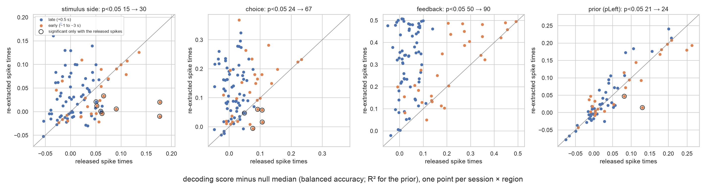
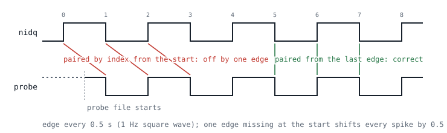
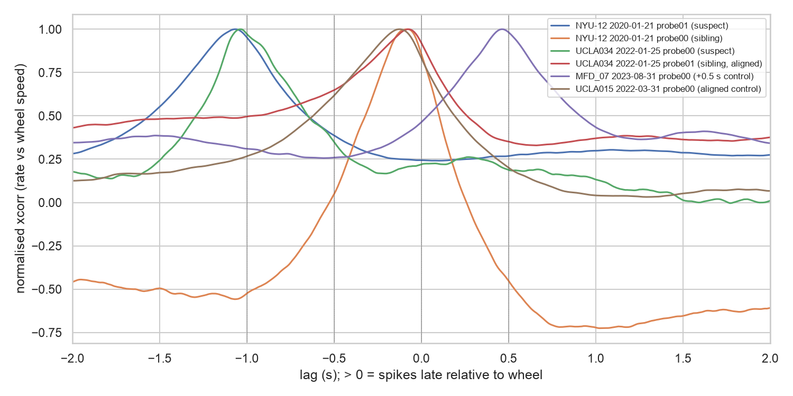
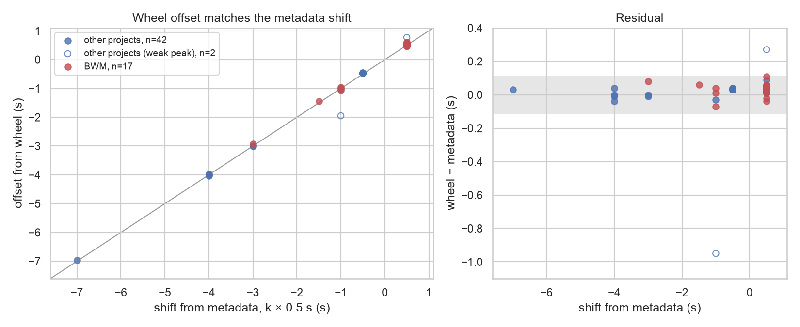

In **69 Neuropixels recordings, 17 of them in the Brain Wide Map release**, the probe sync file is missing its first
sync edges. Every spike is shifted against behaviour by a whole multiple of 0.5 s. Behaviour and video are correct.
The shift can be inferred from the SpikeGLX metadata, and the wheel confirms it on every recording where it can be tested.

| | |
|---|--:|
| probe recordings audited (12 labs, Aug 2019 – Nov 2026) | 4,780 |
| shifted by k × 0.5 s (missing edges at start) | **69** |
| of which in the BWM release (590 3B insertions) | **17** |
| shifted with SpikeGLX `20221012` or later | 0 |

## What it looks like

, same lab, before the problem.](figures/viz/53b3a7c6-ae42-49da-b69c-69e55a43a427.png)

, BWM release, UCLA rig. The sharp feedback response sits at +0.5 s.](figures/viz/92822789-608f-44a6-ad64-fe549402b2df.png)

Trial-aligned activity from the IBL viz site. In an aligned recording, responses lock to stimulus, movement and
feedback at 0 s. In a shifted recording, the whole raster moves by the shift: +0.5 s puts the feedback response at
+0.5 s, and −1.5 s pushes every response out of the plotted window, so the raster looks flat.

## Impact on the Brain Wide Map

**17 of the 590 3B insertions** in the BWM release are shifted. The 109 Neuropixels 3A insertions have no nidq file
and are outside this census.

- **13 come from one UCLA rig** over two months in 2023. They are shifted by +0.5 s, except one at −1.5 s.
- **4 are sporadic whole-second shifts:** NYU-12, SWC_039, ibl_witten_29, and UCLA034 on the same rig in 2022,
  before the problem.
- For all 17, the offset of the population spiking rate corrleated with the wheel agrees with the shift to within 0.11 s.

::: {.callout-warning}
**Any analysis that aligns spikes to task events is affected on these insertions: PSTHs, and decoding or encoding of
stimulus, choice, movement and feedback. A 0.5 s shift moves feedback responses into the next epoch. Shifts of 1 s
or more remove task-locked responses from typical analysis windows.**
:::

| cause | insertion | shift (s) | wheel (s) | links |
|---|---|--:|--:|---|
| UCLA rig | MFD_05/2023-08-15/001 probe00 | +0.5 | +0.61 | [viz](https://viz.internationalbrainlab.org/app?spikesorting=ss_2024-05-06&dset=bwm&pid=d3507787-60c8-4cea-a61e-0c708b4361d8&tid=0&cid=0&qc=0#trialviewer) · [alyx](https://alyx.internationalbrainlab.org/admin/experiments/probeinsertion/d3507787-60c8-4cea-a61e-0c708b4361d8/change/) |
| UCLA rig | MFD_05/2023-08-16/001 probe00 | +0.5 | +0.54 | [viz](https://viz.internationalbrainlab.org/app?spikesorting=ss_2024-05-06&dset=bwm&pid=92822789-608f-44a6-ad64-fe549402b2df&tid=0&cid=0&qc=0#trialviewer) · [alyx](https://alyx.internationalbrainlab.org/admin/experiments/probeinsertion/92822789-608f-44a6-ad64-fe549402b2df/change/) |
| UCLA rig | MFD_05/2023-08-17/001 probe00 | +0.5 | +0.52 | [viz](https://viz.internationalbrainlab.org/app?spikesorting=ss_2024-05-06&dset=bwm&pid=d65ab768-bd77-4719-acb9-677abca4e9d8&tid=0&cid=0&qc=0#trialviewer) · [alyx](https://alyx.internationalbrainlab.org/admin/experiments/probeinsertion/d65ab768-bd77-4719-acb9-677abca4e9d8/change/) |
| UCLA rig | MFD_06/2023-08-22/001 probe00 | +0.5 | +0.56 | [viz](https://viz.internationalbrainlab.org/app?spikesorting=ss_2024-05-06&dset=bwm&pid=069c2674-80b0-44b4-a3d9-28337512967f&tid=0&cid=0&qc=0#trialviewer) · [alyx](https://alyx.internationalbrainlab.org/admin/experiments/probeinsertion/069c2674-80b0-44b4-a3d9-28337512967f/change/) |
| UCLA rig | MFD_06/2023-08-23/001 probe00 | +0.5 | +0.51 | [viz](https://viz.internationalbrainlab.org/app?spikesorting=ss_2024-05-06&dset=bwm&pid=d7187e4f-7bfe-42b3-9e36-761c76eb6e8f&tid=0&cid=0&qc=0#trialviewer) · [alyx](https://alyx.internationalbrainlab.org/admin/experiments/probeinsertion/d7187e4f-7bfe-42b3-9e36-761c76eb6e8f/change/) |
| UCLA rig | MFD_06/2023-08-24/001 probe00 | +0.5 | +0.53 | [viz](https://viz.internationalbrainlab.org/app?spikesorting=ss_2024-05-06&dset=bwm&pid=38e9e5b8-db29-4158-a09d-cc1de4a1365a&tid=0&cid=0&qc=0#trialviewer) · [alyx](https://alyx.internationalbrainlab.org/admin/experiments/probeinsertion/38e9e5b8-db29-4158-a09d-cc1de4a1365a/change/) |
| UCLA rig | MFD_06/2023-08-25/001 probe00 | +0.5 | +0.56 | [viz](https://viz.internationalbrainlab.org/app?spikesorting=ss_2024-05-06&dset=bwm&pid=17fa2600-6349-4b6f-a7e4-d8ea5558fa12&tid=0&cid=0&qc=0#trialviewer) · [alyx](https://alyx.internationalbrainlab.org/admin/experiments/probeinsertion/17fa2600-6349-4b6f-a7e4-d8ea5558fa12/change/) |
| UCLA rig | MFD_07/2023-08-29/001 probe00 | −1.5 | −1.44 | [viz](https://viz.internationalbrainlab.org/app?spikesorting=ss_2024-05-06&dset=bwm&pid=06b677d6-b074-4444-bd4a-3235a310e6e0&tid=0&cid=0&qc=0#trialviewer) · [alyx](https://alyx.internationalbrainlab.org/admin/experiments/probeinsertion/06b677d6-b074-4444-bd4a-3235a310e6e0/change/) |
| UCLA rig | MFD_07/2023-08-31/001 probe00 | +0.5 | +0.54 | [viz](https://viz.internationalbrainlab.org/app?spikesorting=ss_2024-05-06&dset=bwm&pid=7a620688-66cb-44d3-b79b-ccac1c8ba23e&tid=0&cid=0&qc=0#trialviewer) · [alyx](https://alyx.internationalbrainlab.org/admin/experiments/probeinsertion/7a620688-66cb-44d3-b79b-ccac1c8ba23e/change/) |
| UCLA rig | MFD_07/2023-09-01/001 probe00 | +0.5 | +0.53 | [viz](https://viz.internationalbrainlab.org/app?spikesorting=ss_2024-05-06&dset=bwm&pid=24149f5c-2984-4b48-922b-3cd1452cd4bd&tid=0&cid=0&qc=0#trialviewer) · [alyx](https://alyx.internationalbrainlab.org/admin/experiments/probeinsertion/24149f5c-2984-4b48-922b-3cd1452cd4bd/change/) |
| UCLA rig | MFD_08/2023-09-07/001 probe00 | +0.5 | +0.48 | [viz](https://viz.internationalbrainlab.org/app?spikesorting=ss_2024-05-06&dset=bwm&pid=a8a59fc3-a658-4db4-b5e8-09f1e4df03fd&tid=0&cid=0&qc=0#trialviewer) · [alyx](https://alyx.internationalbrainlab.org/admin/experiments/probeinsertion/a8a59fc3-a658-4db4-b5e8-09f1e4df03fd/change/) |
| UCLA rig | MFD_08/2023-09-08/001 probe00 | +0.5 | +0.46 | [viz](https://viz.internationalbrainlab.org/app?spikesorting=ss_2024-05-06&dset=bwm&pid=a759e857-fd8f-4653-a397-c48547230427&tid=0&cid=0&qc=0#trialviewer) · [alyx](https://alyx.internationalbrainlab.org/admin/experiments/probeinsertion/a759e857-fd8f-4653-a397-c48547230427/change/) |
| UCLA rig | MFD_09/2023-10-19/001 probe00 | +0.5 | +0.55 | [viz](https://viz.internationalbrainlab.org/app?spikesorting=ss_2024-05-06&dset=bwm&pid=8c732bf2-639d-496c-bf82-464bc9c2d54b&tid=0&cid=0&qc=0#trialviewer) · [alyx](https://alyx.internationalbrainlab.org/admin/experiments/probeinsertion/8c732bf2-639d-496c-bf82-464bc9c2d54b/change/) |
| sporadic | NYU-12/2020-01-21/001 probe01 | −1.0 | −0.99 | [viz](https://viz.internationalbrainlab.org/app?spikesorting=ss_2024-05-06&dset=bwm&pid=c893c0a3-5597-49cf-baa1-60efdfdef542&tid=0&cid=0&qc=0#trialviewer) · [alyx](https://alyx.internationalbrainlab.org/admin/experiments/probeinsertion/c893c0a3-5597-49cf-baa1-60efdfdef542/change/) |
| sporadic | SWC_039/2020-09-10/001 probe00 | −1.0 | −1.07 | [viz](https://viz.internationalbrainlab.org/app?spikesorting=ss_2024-05-06&dset=bwm&pid=39180bcb-13e5-46f9-89e1-8ea2cba22105&tid=0&cid=0&qc=0#trialviewer) · [alyx](https://alyx.internationalbrainlab.org/admin/experiments/probeinsertion/39180bcb-13e5-46f9-89e1-8ea2cba22105/change/) |
| sporadic | ibl_witten_29/2021-06-14/003 probe00 | −3.0 | −2.92 | [viz](https://viz.internationalbrainlab.org/app?spikesorting=ss_2024-05-06&dset=bwm&pid=7d63ab43-95e4-41f5-bd43-c629578de7a9&tid=0&cid=0&qc=0#trialviewer) · [alyx](https://alyx.internationalbrainlab.org/admin/experiments/probeinsertion/7d63ab43-95e4-41f5-bd43-c629578de7a9/change/) |
| sporadic | UCLA034/2022-01-25/001 probe00 | −1.0 | −0.96 | [viz](https://viz.internationalbrainlab.org/app?spikesorting=ss_2024-05-06&dset=bwm&pid=f9d8aacd-b2a0-49f2-bd71-c2f5aadcfdd1&tid=0&cid=0&qc=0#trialviewer) · [alyx](https://alyx.internationalbrainlab.org/admin/experiments/probeinsertion/f9d8aacd-b2a0-49f2-bd71-c2f5aadcfdd1/change/) |

## Impact on BWM decoding

We reran the BWM decoding of stimulus side, choice and feedback, and the prior decoding of the companion paper, on the
17 BWM sessions, with the released and with the re-extracted spike times ([Methods](#re-extraction-and-decoding)).
Only the affected probe changes, so regions recorded on the session's other probe give identical results.

::: {.callout-note}
These are session-level results on the 17 affected sessions. The region-level results of the papers combine all the
sessions recording a region (Fisher's method), so the effect on their conclusions remains to be computed.
:::

## Impact on other projects
**52 more recordings** outside the BWM release have the same signature.
- **38 come from the same UCLA rig**, 33 of them from MM012 (three probes per session).
- **14 are sporadic**, mostly in the Witten lab dopamine project (dop_47 to dop_53, −1 to −7 s).

| project | labs | subjects | dates | rec. | cause | shift (s) | wheel check |
|---|---|---|---|--:|---|--:|---|
| U19_chronic_NP | churchlandlab_ucla | MM012 | 2023-08-15 → 2023-09-01 | 33 | UCLA rig | −0.5, +0.5 | 33 confirmed |
| ibl_neuropixel_brainwide_01 (outside the release) | churchlandlab_ucla, cortexlab, zadorlab | MFD_06, MFD_07, MFD_08, MFD_09, KS075, CSH_ZAD_021 | 2020-06-15 → 2023-10-20 | 7 | UCLA rig (5), sporadic (2) | −105.0, −1.0, +0.5 | 1 confirmed, 2 weak, 4 not testable |
| witten_dop | wittenlab | dop_47, dop_48, dop_49 | 2022-06-06 → 2022-06-20 | 6 | sporadic | −7.0, −4.0, −1.0 | 6 confirmed |
| witten_learning_dop | wittenlab | dop_53 | 2022-10-05 | 2 | sporadic | −3.0 | 2 confirmed |
| angelaki_mouseASD | angelakilab | CSP004, SH011, NYU-08 | 2019-11-26 → 2020-03-19 | 3 | sporadic | −5.0, −3.0, −1.0 | not testable |
| carandiniharris_midbrain_ibl | cortexlab | KS019 | 2020-03-04 | 1 | sporadic | −2.0 | not testable |
| **total** | | | | **52** | | | **42 confirmed, 2 weak, 8 not testable** |

## Released projects

| group                                | recordings | protected | release tags                                                                                                                                                                                                                                                          |
| ------------------------------------ | ---------: | --------: | --------------------------------------------------------------------------------------------------------------------------------------------------------------------------------------------------------------------------------------------------------------------- |
| BWM release                          | 17         | **17**    | `Brainwidemap`, `2022_Q4_IBL_et_al_BWM`, `2023_Q4_IBL_et_al_BWM_2`, `2024_Q2_IBL_et_al_BWM_iblsort`, `2025_Q3_IBL_et_al_BWM`, `2025_Q3_Zang_et_al_Aging`. 5 are also in `RepeatedSite` / `2024_Q2_IBL_et_al_RepeatedSite`, and 1 in `2023_Q1_Biderman_Whiteway_et_al` |
| Witten dopamine (dop_47, 48, 49, 53) | 8          | **8**     | `2025_Q4_Pan_Vazquez_et_al`                                                                                                                                                                                                                                           |
| MFD_06 2023-08-29 probe00            | 1          | **1**     | `2024_Q2_IBL_et_al_RepeatedSite`, `RepeatedSite`                                                                                                                                                                                                                      |
| all other projects                   | 43         | 0         | none                                                                                                                                                                                                                                                                  |

## Root cause

Older versions of spikeGLX (before `20221012`) had sporadic instances of "mistarts" where first edges were missing (18, 4 of them BWM, multiple labs). 
This has been fixed in `20221012`. However in UCLA, one rig did get a firmware upgrade while staying on the older spikeGLX version, resulting 
in a systematic shift. This represents 51 sessions from a single rig, 13 of them BWM.

### Sporadic cases (18 recordings / 4 of which BWM)

18 recordings are spread over 6 labs from 2019 to 2022, on SpikeGLX `20190327`, `20190413` and `20201103`.
In all of them, the probe file misses an even number of edges at the start. The shift is therefore a whole number of
seconds and always negative (spikes early). We have not found a common hardware or software cause.

### The UCLA rig (51 recordings / 13 of which BWM)

All 51 shifted recordings on the Churchland lab UCLA rig share one combination: SpikeGLX `20201103` running on
base-station firmware `2.0.169` with connect-card firmware `3.2.186`. That combination was used only from 15 Aug to
20 Oct 2023, and every recording made with it is shifted.

- **Up to 13 Aug 2023:** old firmware `3.2.176`, 322 recordings. Only one is shifted (UCLA034 2022-01-25, a sporadic
  case). MFD_05 recordings before the upgrade are aligned.
- **14–15 Aug 2023:** the firmware upgrade lands. From then on, every recording made with SpikeGLX `20201103` is
  shifted, mostly by +0.5 s. MM012 sessions alternate between +0.5 and −0.5 s.
- **29 Aug 2023:** the headstage, flex and probe on MFD_07 are swapped (headstage firmware 5.1 → 5.3, flex
  1.2 → 4.13). The first run on the new hardware is shifted by −1.5 s, with `firstSample` off the 0.5 s grid.
  From 30 Aug it is back to +0.5 s.
- **20 Oct 2023:** last shifted recording (MFD_09).

Firmware `3.2.186` alone is not the cause. From 14 Aug, the same base station also recorded 490 sessions with SpikeGLX
`20230411` (MM009 to MM015, MM012 included), and none is shifted. Both versions were in use on that base station over
the same weeks, and only the old version on the new firmware shifts. The new firmware probably came with SpikeGLX
`20230411`, and the old version kept being launched against it. This is inferred from the dates and has not been
confirmed with the lab.

### Mechanism

SpikeGLX records a 1 Hz square wave on both the nidq (behaviour) and the probe streams, with an edge every 0.5 s.
`ibllib` (`version3B`) pairs the edges of the two streams by index, starting from the first. The specification states
that the edges are aligned from the start: ["With sync enabled, SpikeGLX uses the edges so that files in a new set all start at a common wall time"](https://billkarsh.github.io/SpikeGLX/help/syncEdges/Sync_edges/)

When this is not the case, every pair is off by *k* edges and spikes shift by *k* × 0.5 s. The edges still pair one-to-one and regularly, so the sync QC passes.

## Methods

### Validation against the wheel

The wheel is recorded on the nidq clock and is not periodic, so cross-correlating the population firing rate with
wheel speed measures the true offset directly. Aligned recordings peak just below 0 s, because neural activity leads
movement by tens of milliseconds. We subtract that baseline, taken as the median over 30 aligned BWM insertions.

### Detection and correction from the metadata

For each recording we compare the two streams' `fileTimeSecs` and sync edge counts. A recording that is missing edges
at the start shows all three of these:

1. the file durations differ by *dT*, with *k* = round(*dT* / 0.5 s) ≠ 0;
2. the edge counts differ by exactly *k*;
3. the edges are otherwise regular (every interval between 0.25 and 0.75 s) and complete at both ends.

The correction is to pair the edges from the last one, which drops the first |*k*| edges of the longer stream. Spikes
then move by *k* × 0.5 s. No raw data and no re-sorting are needed.

::: {.callout-note}
The edges alone cannot say whether the missing edges are at the start (a shift) or at the end (a truncated file, no
shift), so the wheel was used to check. Every testable case was a shift.

In **SpikeGLX `20221012` and later:** the `firstSample` field is reliable and settles it. These 1,432 recordings show no shift and one truncation (KM_041).
:::

### Re-extraction and decoding

**Re-extraction.** For each insertion, the sync QC (`ibldsp.sync.spikeglx_sync_qc`, ibl-neuropixel branch
`sync-criteria`) must fail only on the durations and the edge counts, with the edge-count difference equal to *k*.
The probe and nidq edges are then paired from the last edge, and the probe sync is fitted as in ibllib `version3B`.
`spikes.times` are recomputed from `spikes.samples` for every spike sorting collection. The re-extracted datasets
are in `/mnt/home/owinter/ceph/sync_lag/<pid>/` on popeye, in the ALF layout; they are not registered on Alyx.

**Decoding.** BWM settings (prior-localization, branch `sirena`): probes merged per session, good units of the
spike sorting revision `2024-05-06`, L1 logistic regression, 10 runs of nested 5-fold cross-validation, 200
pseudo-sessions, BWM trial selection and saturation flags. Windows: stimulus side 0 to 100 ms after stimulus onset,
choice 100 ms before first movement, feedback 0 to 200 ms after feedback. The prior follows the companion paper:
Bayes-optimal prior, −600 to −100 ms before stimulus onset, Lasso, R², at least 250 trials. The score is the mean
over the 10 runs, minus the median of the pseudo-sessions; the p-value is the rank of the score among them. With
the re-extracted spike times, only the spikes of the affected probe change, through the released and the new probe
syncs. Code: `sdsc-slurms/2026-11_probe-sync-lag`; figures and tables: `scripts/016_reextraction_report.py`.

## Appendix: all affected insertions
All 69 recordings labelled *missing edges at start*. The shift is predicted from the metadata (*k* × 0.5 s, positive
= spikes late). The wheel offset is given where spike sorting exists; "weak" marks a wheel correlation with SNR < 2.
Insertions link to Alyx; two recordings have no registered insertion.

| project | lab | session | probe | BWM release | predicted shift (s) | wheel (s) |
|---|---|---|---|---|--:|--:|
| U19_chronic_NP | churchlandlab_ucla | MM012/2023-08-15/001 | [probe00](https://alyx.internationalbrainlab.org/admin/experiments/probeinsertion/1ac45cad-4f30-4fc0-9911-74cc86d459ab/change/) |  | +0.5 | +0.55 |
| U19_chronic_NP | churchlandlab_ucla | MM012/2023-08-15/001 | [probe01](https://alyx.internationalbrainlab.org/admin/experiments/probeinsertion/3c9654fa-593d-42d2-b95b-8c95a7fcb827/change/) |  | +0.5 | +0.55 |
| U19_chronic_NP | churchlandlab_ucla | MM012/2023-08-15/001 | [probe02](https://alyx.internationalbrainlab.org/admin/experiments/probeinsertion/e34de57a-fc9f-41ce-b856-e018e1d16b5f/change/) |  | +0.5 | +0.54 |
| U19_chronic_NP | churchlandlab_ucla | MM012/2023-08-17/001 | [probe00](https://alyx.internationalbrainlab.org/admin/experiments/probeinsertion/abb5829b-ef22-4287-a091-f7c5d605ea03/change/) |  | −0.5 | −0.46 |
| U19_chronic_NP | churchlandlab_ucla | MM012/2023-08-17/001 | [probe01](https://alyx.internationalbrainlab.org/admin/experiments/probeinsertion/fbedddaf-d15e-420a-8f33-cc7a296908d9/change/) |  | −0.5 | −0.46 |
| U19_chronic_NP | churchlandlab_ucla | MM012/2023-08-17/001 | [probe02](https://alyx.internationalbrainlab.org/admin/experiments/probeinsertion/cf283616-9f75-415f-8750-701b13de1d3c/change/) |  | −0.5 | −0.47 |
| U19_chronic_NP | churchlandlab_ucla | MM012/2023-08-18/001 | [probe00](https://alyx.internationalbrainlab.org/admin/experiments/probeinsertion/3ef00159-cd8f-48b0-900b-455106ddad31/change/) |  | −0.5 | −0.47 |
| U19_chronic_NP | churchlandlab_ucla | MM012/2023-08-18/001 | [probe01](https://alyx.internationalbrainlab.org/admin/experiments/probeinsertion/2b2473fd-b06a-4936-a7df-3674858b3b2c/change/) |  | −0.5 | −0.47 |
| U19_chronic_NP | churchlandlab_ucla | MM012/2023-08-18/001 | [probe02](https://alyx.internationalbrainlab.org/admin/experiments/probeinsertion/dc32b7cc-d996-4e5c-9f6f-d883b24356bc/change/) |  | −0.5 | −0.47 |
| U19_chronic_NP | churchlandlab_ucla | MM012/2023-08-21/001 | [probe00](https://alyx.internationalbrainlab.org/admin/experiments/probeinsertion/45fa361e-666e-4d45-9f20-a9cd572bf2cb/change/) |  | +0.5 | +0.54 |
| U19_chronic_NP | churchlandlab_ucla | MM012/2023-08-21/001 | [probe01](https://alyx.internationalbrainlab.org/admin/experiments/probeinsertion/6540aca9-2e93-4677-bf33-e33b9980101e/change/) |  | +0.5 | +0.54 |
| U19_chronic_NP | churchlandlab_ucla | MM012/2023-08-21/001 | [probe02](https://alyx.internationalbrainlab.org/admin/experiments/probeinsertion/4fdc926b-efe8-493a-b779-4ec7a7b3cea4/change/) |  | +0.5 | +0.55 |
| U19_chronic_NP | churchlandlab_ucla | MM012/2023-08-22/001 | [probe00](https://alyx.internationalbrainlab.org/admin/experiments/probeinsertion/0d084154-5e8d-4e54-99b0-ef8a8c9d1f8d/change/) |  | −0.5 | −0.47 |
| U19_chronic_NP | churchlandlab_ucla | MM012/2023-08-22/001 | [probe01](https://alyx.internationalbrainlab.org/admin/experiments/probeinsertion/093af021-566d-470e-8c18-d0343b6479da/change/) |  | −0.5 | −0.47 |
| U19_chronic_NP | churchlandlab_ucla | MM012/2023-08-22/001 | [probe02](https://alyx.internationalbrainlab.org/admin/experiments/probeinsertion/cb6c0e42-b894-4baf-87eb-066eacf9c86e/change/) |  | −0.5 | −0.47 |
| U19_chronic_NP | churchlandlab_ucla | MM012/2023-08-23/001 | [probe00](https://alyx.internationalbrainlab.org/admin/experiments/probeinsertion/61387de7-df05-49bb-8a86-3e46f5d2dbb7/change/) |  | +0.5 | +0.52 |
| U19_chronic_NP | churchlandlab_ucla | MM012/2023-08-23/001 | [probe01](https://alyx.internationalbrainlab.org/admin/experiments/probeinsertion/3f14d9fc-c5f7-4601-8714-860803ccb6f7/change/) |  | +0.5 | +0.53 |
| U19_chronic_NP | churchlandlab_ucla | MM012/2023-08-23/001 | [probe02](https://alyx.internationalbrainlab.org/admin/experiments/probeinsertion/4039ca62-c137-4ec7-b349-f57e0422dae9/change/) |  | +0.5 | +0.52 |
| U19_chronic_NP | churchlandlab_ucla | MM012/2023-08-24/001 | [probe00](https://alyx.internationalbrainlab.org/admin/experiments/probeinsertion/0e5b7e25-e62b-4d3b-a0ad-04d51adb0a14/change/) |  | +0.5 | +0.51 |
| U19_chronic_NP | churchlandlab_ucla | MM012/2023-08-24/001 | [probe01](https://alyx.internationalbrainlab.org/admin/experiments/probeinsertion/564b4199-4742-4376-be30-598bc5d901c5/change/) |  | +0.5 | +0.53 |
| U19_chronic_NP | churchlandlab_ucla | MM012/2023-08-24/001 | [probe02](https://alyx.internationalbrainlab.org/admin/experiments/probeinsertion/8bb8a8b0-0696-48b5-83e7-bb27d99e1a33/change/) |  | +0.5 | +0.52 |
| U19_chronic_NP | churchlandlab_ucla | MM012/2023-08-25/001 | [probe00](https://alyx.internationalbrainlab.org/admin/experiments/probeinsertion/f21c3ac2-5ddc-44d5-b6c5-25360fc68314/change/) |  | +0.5 | +0.52 |
| U19_chronic_NP | churchlandlab_ucla | MM012/2023-08-25/001 | [probe01](https://alyx.internationalbrainlab.org/admin/experiments/probeinsertion/1f199ee3-ed0c-4f60-b104-9cfaf510a0a5/change/) |  | +0.5 | +0.53 |
| U19_chronic_NP | churchlandlab_ucla | MM012/2023-08-25/001 | [probe02](https://alyx.internationalbrainlab.org/admin/experiments/probeinsertion/de38e7ca-d1da-47fc-a9b3-1d97cec5084c/change/) |  | +0.5 | +0.51 |
| U19_chronic_NP | churchlandlab_ucla | MM012/2023-08-27/001 | [probe00](https://alyx.internationalbrainlab.org/admin/experiments/probeinsertion/f01bdac8-fc74-4963-812a-754d3e2c2fd6/change/) |  | +0.5 | +0.52 |
| U19_chronic_NP | churchlandlab_ucla | MM012/2023-08-27/001 | [probe01](https://alyx.internationalbrainlab.org/admin/experiments/probeinsertion/a174d7c9-dbea-40ab-bad9-5f1496632740/change/) |  | +0.5 | +0.53 |
| U19_chronic_NP | churchlandlab_ucla | MM012/2023-08-27/001 | [probe02](https://alyx.internationalbrainlab.org/admin/experiments/probeinsertion/035c7ed5-e2ee-4e65-b3b9-40b4d0473463/change/) |  | +0.5 | +0.52 |
| U19_chronic_NP | churchlandlab_ucla | MM012/2023-08-28/001 | [probe00](https://alyx.internationalbrainlab.org/admin/experiments/probeinsertion/4d306b7a-6a36-4f91-95e4-d9c7c6e998d8/change/) |  | +0.5 | +0.52 |
| U19_chronic_NP | churchlandlab_ucla | MM012/2023-08-28/001 | [probe01](https://alyx.internationalbrainlab.org/admin/experiments/probeinsertion/774c734e-970d-42a7-bf1f-6066078e5b61/change/) |  | +0.5 | +0.53 |
| U19_chronic_NP | churchlandlab_ucla | MM012/2023-08-28/001 | [probe02](https://alyx.internationalbrainlab.org/admin/experiments/probeinsertion/0a665d8a-1662-409d-84bb-936b23bfc1d5/change/) |  | +0.5 | +0.53 |
| U19_chronic_NP | churchlandlab_ucla | MM012/2023-09-01/001 | [probe00](https://alyx.internationalbrainlab.org/admin/experiments/probeinsertion/9eae6373-e7ea-472b-91ad-9b8f57e18f8e/change/) |  | +0.5 | +0.51 |
| U19_chronic_NP | churchlandlab_ucla | MM012/2023-09-01/001 | [probe01](https://alyx.internationalbrainlab.org/admin/experiments/probeinsertion/1b96edbe-bd55-447f-86cd-5a8f803bc587/change/) |  | +0.5 | +0.53 |
| U19_chronic_NP | churchlandlab_ucla | MM012/2023-09-01/001 | [probe02](https://alyx.internationalbrainlab.org/admin/experiments/probeinsertion/03ff18ad-bc7d-4310-9853-15621a3da6b5/change/) |  | +0.5 | +0.54 |
| angelaki_mouseASD | angelakilab | CSP004/2019-11-26/001 | [probe01](https://alyx.internationalbrainlab.org/admin/experiments/probeinsertion/c59520cf-d52c-4bf2-90cc-e6924ab7bf2b/change/) |  | −1.0 |  |
| angelaki_mouseASD | angelakilab | SH011/2020-02-06/001 | [probe01](https://alyx.internationalbrainlab.org/admin/experiments/probeinsertion/7b00f29f-f67f-4fa9-b4c9-e844c44b7b6b/change/) |  | −5.0 |  |
| angelaki_mouseASD | angelakilab | NYU-08/2020-03-19/001 | [probe01](https://alyx.internationalbrainlab.org/admin/experiments/probeinsertion/c18a4246-6f73-4e09-b5ea-2ad9854cc3eb/change/) |  | −3.0 |  |
| carandiniharris_midbrain_ibl | cortexlab | KS019/2020-03-04/001 | probe00 (no insertion) |  | −2.0 |  |
| ibl_neuropixel_brainwide_01 | angelakilab | NYU-12/2020-01-21/001 | [probe01](https://alyx.internationalbrainlab.org/admin/experiments/probeinsertion/c893c0a3-5597-49cf-baa1-60efdfdef542/change/) | yes | −1.0 | −0.99 |
| ibl_neuropixel_brainwide_01 | churchlandlab_ucla | UCLA034/2022-01-25/001 | [probe00](https://alyx.internationalbrainlab.org/admin/experiments/probeinsertion/f9d8aacd-b2a0-49f2-bd71-c2f5aadcfdd1/change/) | yes | −1.0 | −0.96 |
| ibl_neuropixel_brainwide_01 | churchlandlab_ucla | MFD_05/2023-08-15/001 | [probe00](https://alyx.internationalbrainlab.org/admin/experiments/probeinsertion/d3507787-60c8-4cea-a61e-0c708b4361d8/change/) | yes | +0.5 | +0.61 |
| ibl_neuropixel_brainwide_01 | churchlandlab_ucla | MFD_05/2023-08-16/001 | [probe00](https://alyx.internationalbrainlab.org/admin/experiments/probeinsertion/92822789-608f-44a6-ad64-fe549402b2df/change/) | yes | +0.5 | +0.54 |
| ibl_neuropixel_brainwide_01 | churchlandlab_ucla | MFD_05/2023-08-17/001 | [probe00](https://alyx.internationalbrainlab.org/admin/experiments/probeinsertion/d65ab768-bd77-4719-acb9-677abca4e9d8/change/) | yes | +0.5 | +0.52 |
| ibl_neuropixel_brainwide_01 | churchlandlab_ucla | MFD_06/2023-08-22/001 | [probe00](https://alyx.internationalbrainlab.org/admin/experiments/probeinsertion/069c2674-80b0-44b4-a3d9-28337512967f/change/) | yes | +0.5 | +0.56 |
| ibl_neuropixel_brainwide_01 | churchlandlab_ucla | MFD_06/2023-08-23/001 | [probe00](https://alyx.internationalbrainlab.org/admin/experiments/probeinsertion/d7187e4f-7bfe-42b3-9e36-761c76eb6e8f/change/) | yes | +0.5 | +0.51 |
| ibl_neuropixel_brainwide_01 | churchlandlab_ucla | MFD_06/2023-08-24/001 | [probe00](https://alyx.internationalbrainlab.org/admin/experiments/probeinsertion/38e9e5b8-db29-4158-a09d-cc1de4a1365a/change/) | yes | +0.5 | +0.53 |
| ibl_neuropixel_brainwide_01 | churchlandlab_ucla | MFD_06/2023-08-25/001 | [probe00](https://alyx.internationalbrainlab.org/admin/experiments/probeinsertion/17fa2600-6349-4b6f-a7e4-d8ea5558fa12/change/) | yes | +0.5 | +0.56 |
| ibl_neuropixel_brainwide_01 | churchlandlab_ucla | MFD_07/2023-08-29/001 | [probe00](https://alyx.internationalbrainlab.org/admin/experiments/probeinsertion/06b677d6-b074-4444-bd4a-3235a310e6e0/change/) | yes | −1.5 | −1.44 |
| ibl_neuropixel_brainwide_01 | churchlandlab_ucla | MFD_06/2023-08-29/001 | [probe00](https://alyx.internationalbrainlab.org/admin/experiments/probeinsertion/730770d6-617a-4ada-95db-a48521befda5/change/) |  | +0.5 | +0.59 |
| ibl_neuropixel_brainwide_01 | churchlandlab_ucla | MFD_07/2023-08-30/001 | probe00 (no insertion) |  | +0.5 |  |
| ibl_neuropixel_brainwide_01 | churchlandlab_ucla | MFD_07/2023-08-31/001 | [probe00](https://alyx.internationalbrainlab.org/admin/experiments/probeinsertion/7a620688-66cb-44d3-b79b-ccac1c8ba23e/change/) | yes | +0.5 | +0.54 |
| ibl_neuropixel_brainwide_01 | churchlandlab_ucla | MFD_07/2023-09-01/001 | [probe00](https://alyx.internationalbrainlab.org/admin/experiments/probeinsertion/24149f5c-2984-4b48-922b-3cd1452cd4bd/change/) | yes | +0.5 | +0.53 |
| ibl_neuropixel_brainwide_01 | churchlandlab_ucla | MFD_08/2023-09-06/001 | [probe00](https://alyx.internationalbrainlab.org/admin/experiments/probeinsertion/c78432d0-42b0-4837-ab64-bc68918f38a9/change/) |  | +0.5 |  |
| ibl_neuropixel_brainwide_01 | churchlandlab_ucla | MFD_08/2023-09-07/001 | [probe00](https://alyx.internationalbrainlab.org/admin/experiments/probeinsertion/a8a59fc3-a658-4db4-b5e8-09f1e4df03fd/change/) | yes | +0.5 | +0.48 |
| ibl_neuropixel_brainwide_01 | churchlandlab_ucla | MFD_08/2023-09-08/001 | [probe00](https://alyx.internationalbrainlab.org/admin/experiments/probeinsertion/a759e857-fd8f-4653-a397-c48547230427/change/) | yes | +0.5 | +0.46 |
| ibl_neuropixel_brainwide_01 | churchlandlab_ucla | MFD_09/2023-10-18/001 | [probe00](https://alyx.internationalbrainlab.org/admin/experiments/probeinsertion/64346da1-c8f0-494f-a9b9-c415d7da582b/change/) |  | +0.5 | +0.77, weak |
| ibl_neuropixel_brainwide_01 | churchlandlab_ucla | MFD_09/2023-10-19/001 | [probe00](https://alyx.internationalbrainlab.org/admin/experiments/probeinsertion/8c732bf2-639d-496c-bf82-464bc9c2d54b/change/) | yes | +0.5 | +0.55 |
| ibl_neuropixel_brainwide_01 | churchlandlab_ucla | MFD_09/2023-10-20/001 | [probe00](https://alyx.internationalbrainlab.org/admin/experiments/probeinsertion/915a3b71-1558-4796-b5ae-7c8faf6d7ed7/change/) |  | +0.5 |  |
| ibl_neuropixel_brainwide_01 | cortexlab | KS075/2021-12-12/001 | [probe00](https://alyx.internationalbrainlab.org/admin/experiments/probeinsertion/b825c7ec-12b3-44f8-92f4-0f5711380242/change/) |  | −1.0 | −1.95, weak |
| ibl_neuropixel_brainwide_01 | mrsicflogellab | SWC_039/2020-09-10/001 | [probe00](https://alyx.internationalbrainlab.org/admin/experiments/probeinsertion/39180bcb-13e5-46f9-89e1-8ea2cba22105/change/) | yes | −1.0 | −1.07 |
| ibl_neuropixel_brainwide_01 | wittenlab | ibl_witten_29/2021-06-14/003 | [probe00](https://alyx.internationalbrainlab.org/admin/experiments/probeinsertion/7d63ab43-95e4-41f5-bd43-c629578de7a9/change/) | yes | −3.0 | −2.92 |
| ibl_neuropixel_brainwide_01 | zadorlab | CSH_ZAD_021/2020-06-15/001 | [probe01](https://alyx.internationalbrainlab.org/admin/experiments/probeinsertion/0c507913-94f0-4bbb-9c45-e0dd38ef7635/change/) |  | −105.0 |  |
| witten_dop | wittenlab | dop_47/2022-06-06/001 | [probe00](https://alyx.internationalbrainlab.org/admin/experiments/probeinsertion/73696336-a190-4008-a688-8b88df5b707a/change/) |  | −4.0 | −4.0 |
| witten_dop | wittenlab | dop_47/2022-06-06/001 | [probe01](https://alyx.internationalbrainlab.org/admin/experiments/probeinsertion/30924eb8-9285-4f2e-b5f7-308ae7b604a1/change/) |  | −4.0 | −4.01 |
| witten_dop | wittenlab | dop_47/2022-06-06/001 | [probe02](https://alyx.internationalbrainlab.org/admin/experiments/probeinsertion/9684a9a1-d3ac-4bb0-bf12-9912f2610adc/change/) |  | −4.0 | −3.96 |
| witten_dop | wittenlab | dop_47/2022-06-06/001 | [probe03](https://alyx.internationalbrainlab.org/admin/experiments/probeinsertion/e399a196-f0f3-4231-a196-0b59a3a3bcdf/change/) |  | −4.0 | −4.04 |
| witten_dop | wittenlab | dop_49/2022-06-18/002 | [probe00](https://alyx.internationalbrainlab.org/admin/experiments/probeinsertion/03d9a7d6-1aa6-4830-aa5d-7b917bec19f8/change/) |  | −7.0 | −6.97 |
| witten_dop | wittenlab | dop_48/2022-06-20/001 | [probe00](https://alyx.internationalbrainlab.org/admin/experiments/probeinsertion/d6e54c4f-2919-48a7-8eec-dfcd7845b37b/change/) |  | −1.0 | −1.03 |
| witten_learning_dop | wittenlab | dop_53/2022-10-05/001 | [probe00](https://alyx.internationalbrainlab.org/admin/experiments/probeinsertion/db84d53c-53da-4e54-b002-3372b6f74545/change/) |  | −3.0 | −3.01 |
| witten_learning_dop | wittenlab | dop_53/2022-10-05/001 | [probe02](https://alyx.internationalbrainlab.org/admin/experiments/probeinsertion/948cc48b-9ca2-42aa-b640-112ed9138e3d/change/) |  | −3.0 | −3.0 |

The full audit list is in the [sync issues sheet](https://docs.google.com/spreadsheets/d/19EOII-jMn7_EJ0_Kdwz95kL-1o-opHazSxNvGgKq0Vc).
