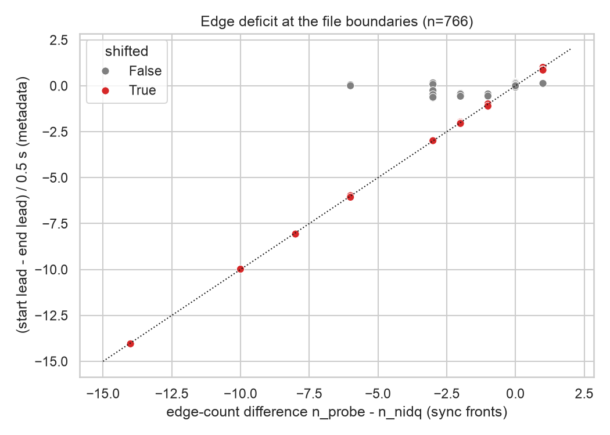
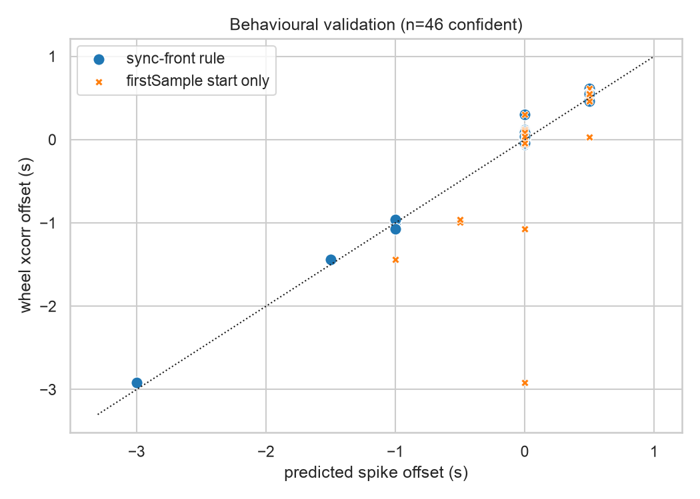

## Overview

In 13 Brain Wide Map insertions from `churchlandlab_ucla` (MFD_05 to MFD_09, Aug–Oct 2023), every population
response arrives about +0.515 s late relative to trial events, and stimulus decoding is at chance. The trial
tables and the spike-sorting outputs both check out. The offset comes from the probe-to-session clock mapping.

**Root cause.** The imec sync is a 1 Hz square wave, so it has a front every 0.5 s.
[`ibllib.ephys.sync_probes.version3B`](https://github.com/int-brain-lab/ibllib/blob/develop/ibllib/ephys/sync_probes.py)
pairs probe and nidq fronts **by index from the start**: `times[:min(n_probe, n_nidq)]`. That assumes both files
start on the same front.

- If the probe file starts *k* fronts early or late, every spike shifts by *k* × 0.5 s.
- The fit residuals stay flat for any *k*, so the sync QC passes.
- A front-count mismatch only produces a log warning.

**Damage.** Across the 8,689 3B probes on Alyx that have a nidq file, **80 probes in 50 sessions are shifted**:

| | probes |
|---|---|
| shifted, total | 80 |
| in the BWM 2023 release | 17 (of 699) |
| in the BWM project | 24 |
| shift range | −8.0 to +1.0 s |

Two mechanisms account for them:

- **A: SpikeGLX `20201103` + base-station firmware `2.0.169 / 3.2.186`.** 51 of 51 probes are shifted, all
  `churchlandlab_ucla` (MFD_05–09, MM012), recorded 2023-08-15 to 2023-10-20 on a single base station
  (SN 21230842). The firmware arrived together with SpikeGLX `20230411` on 2023-08-14. The same base station ran
  790 probes under the new SpikeGLX, all aligned. The MFD/MM012 experiments kept running on the old
  `20201103` install, which mis-aligns the probe file start by one sync front, mostly +0.5 s.
- **B: older SpikeGLX versions (2019–2024), sporadic.** 29 probes across 8 labs, shifted −8 to +1 s. The probe
  file starts several fronts late. There is no single version pattern. Wittenlab (dop_*) accounts for 14.

**Validation.** Wheel speed is recorded on the nidq clock and is aperiodic, so its cross-correlation with
population rate measures the spike offset without the half-period ambiguity of the sync wave. On the 46
insertions with a confident estimate:

- the sync-front rule below matches the wheel estimate in **45 of 46** cases, including −3.0, −1.5 and −1.0 s
  shifts;
- the one disagreement (DY_018 probe01, +0.30 s) has clean sync and is a different problem.

Session-level report for the UCLA rig (mechanism A): [UCLA rig, Aug–Oct 2023](ucla_rig.qmd).

## Mechanism

SpikeGLX starts the probe and nidq files on the same phase of the sync square wave. In all 674 BWM-era
insertions checked, the first front of each stream falls at the same time in file time, to within 1 ms. The true
start offset is therefore always a whole number *k* of half-periods, and the fronts alone cannot reveal *k*.

The SpikeGLX metadata records `firstSample`, the index of each file's first sample since the start of the run. It
should give the offset directly:

```
start_lead = firstSample_nidq / niSampRate - firstSample_probe / imSampRate   # > 0: probe started first
```

In practice, `firstSample` carries a shared error of up to ~3.6 s on older SpikeGLX versions. On the wheel-validated
cases, `firstSample` alone gets 39 of 46 right; it fails at −1.0 s and −3.0 s. That error cancels in the difference
between the start and end offsets:

```
boundary = (start_lead - end_lead) / 0.5     # fronts gained at the start minus fronts lost at the end
```

`boundary` equals the front-count difference `n_probe - n_nidq` exactly whenever the extra or missing fronts sit
at the file boundaries (red points below). The files then end together, so *k* = `boundary`. When fronts are lost
mid-recording (grey points off the diagonal), the deficit is not at the boundaries and *k* = 0. Those probes are
correctly synced.

::: {layout-ncol=2}



:::

**Rule (no behaviour needed):** shift = 0.5 s × `round(boundary)` when `boundary` is within 0.25 of an integer
and |`boundary`| ≤ 20. It can be computed from the two `.meta` files alone and agrees with the sync-front version
on all 781 probes where both exist.

### Mechanism A on the UCLA rig


On mechanism A probes, the probe also sees the sync wave differently. The high-minus-low half-period asymmetry
is about +66 µs (2 samples) on every other probe, and about 0 µs on these. The first-front polarity is the same on
both streams even though the pairing is offset by one front, which suggests the probe sees the wave inverted.

### Wheel cross-correlation

Population rate (10 ms bins) is cross-correlated with the absolute wheel speed (50 ms boxcar) over the whole
session. On 30 random aligned controls, the peak sits at −0.08 s (neural activity leads movement), and offsets are
measured from that baseline. Confidence requires a peak SNR ≥ 2 and a 10-block bootstrap CI narrower than 0.3 s.
Sibling probes from the same sessions show the effect is per probe: UCLA034 probe00 is at −1.0 s while probe01
is aligned.


## Damage report

### BWM insertions

Mechanism A is +0.5 s except MFD_07 2023-08-29. "Wheel" is the measured offset where confident.

| insertion | BWM release | shift (s) | wheel (s) | mech. |
|---|---|---|---|---|
| [7d63ab43-95e4-41f5-bd43-c629578de7a9 ibl_witten_29/2021-06-14/003 probe00](https://alyx.internationalbrainlab.org/admin/experiments/probeinsertion/7d63ab43-95e4-41f5-bd43-c629578de7a9/change/) | yes | −3.0 | −2.92 | B |
| [06b677d6-b074-4444-bd4a-3235a310e6e0 MFD_07/2023-08-29/001 probe00](https://alyx.internationalbrainlab.org/admin/experiments/probeinsertion/06b677d6-b074-4444-bd4a-3235a310e6e0/change/) | yes | −1.5 | −1.44 | A |
| [c893c0a3-5597-49cf-baa1-60efdfdef542 NYU-12/2020-01-21/001 probe01](https://alyx.internationalbrainlab.org/admin/experiments/probeinsertion/c893c0a3-5597-49cf-baa1-60efdfdef542/change/) | yes | −1.0 | −0.99 | B |
| [39180bcb-13e5-46f9-89e1-8ea2cba22105 SWC_039/2020-09-10/001 probe00](https://alyx.internationalbrainlab.org/admin/experiments/probeinsertion/39180bcb-13e5-46f9-89e1-8ea2cba22105/change/) | yes | −1.0 | −1.07 | B |
| [f9d8aacd-b2a0-49f2-bd71-c2f5aadcfdd1 UCLA034/2022-01-25/001 probe00](https://alyx.internationalbrainlab.org/admin/experiments/probeinsertion/f9d8aacd-b2a0-49f2-bd71-c2f5aadcfdd1/change/) | yes | −1.0 | −0.96 | B |
| [d3507787-60c8-4cea-a61e-0c708b4361d8 MFD_05/2023-08-15/001 probe00](https://alyx.internationalbrainlab.org/admin/experiments/probeinsertion/d3507787-60c8-4cea-a61e-0c708b4361d8/change/) | yes | +0.5 | +0.61 | A |
| [92822789-608f-44a6-ad64-fe549402b2df MFD_05/2023-08-16/001 probe00](https://alyx.internationalbrainlab.org/admin/experiments/probeinsertion/92822789-608f-44a6-ad64-fe549402b2df/change/) | yes | +0.5 | +0.54 | A |
| [d65ab768-bd77-4719-acb9-677abca4e9d8 MFD_05/2023-08-17/001 probe00](https://alyx.internationalbrainlab.org/admin/experiments/probeinsertion/d65ab768-bd77-4719-acb9-677abca4e9d8/change/) | yes | +0.5 | +0.52 | A |
| [069c2674-80b0-44b4-a3d9-28337512967f MFD_06/2023-08-22/001 probe00](https://alyx.internationalbrainlab.org/admin/experiments/probeinsertion/069c2674-80b0-44b4-a3d9-28337512967f/change/) | yes | +0.5 | +0.56 | A |
| [d7187e4f-7bfe-42b3-9e36-761c76eb6e8f MFD_06/2023-08-23/001 probe00](https://alyx.internationalbrainlab.org/admin/experiments/probeinsertion/d7187e4f-7bfe-42b3-9e36-761c76eb6e8f/change/) | yes | +0.5 | +0.51 | A |
| [38e9e5b8-db29-4158-a09d-cc1de4a1365a MFD_06/2023-08-24/001 probe00](https://alyx.internationalbrainlab.org/admin/experiments/probeinsertion/38e9e5b8-db29-4158-a09d-cc1de4a1365a/change/) | yes | +0.5 | +0.53 | A |
| [17fa2600-6349-4b6f-a7e4-d8ea5558fa12 MFD_06/2023-08-25/001 probe00](https://alyx.internationalbrainlab.org/admin/experiments/probeinsertion/17fa2600-6349-4b6f-a7e4-d8ea5558fa12/change/) | yes | +0.5 | +0.56 | A |
| [730770d6-617a-4ada-95db-a48521befda5 MFD_06/2023-08-29/001 probe00](https://alyx.internationalbrainlab.org/admin/experiments/probeinsertion/730770d6-617a-4ada-95db-a48521befda5/change/) | no | +0.5 | | A |
| [7a620688-66cb-44d3-b79b-ccac1c8ba23e MFD_07/2023-08-31/001 probe00](https://alyx.internationalbrainlab.org/admin/experiments/probeinsertion/7a620688-66cb-44d3-b79b-ccac1c8ba23e/change/) | yes | +0.5 | +0.54 | A |
| [24149f5c-2984-4b48-922b-3cd1452cd4bd MFD_07/2023-09-01/001 probe00](https://alyx.internationalbrainlab.org/admin/experiments/probeinsertion/24149f5c-2984-4b48-922b-3cd1452cd4bd/change/) | yes | +0.5 | +0.53 | A |
| [c78432d0-42b0-4837-ab64-bc68918f38a9 MFD_08/2023-09-06/001 probe00](https://alyx.internationalbrainlab.org/admin/experiments/probeinsertion/c78432d0-42b0-4837-ab64-bc68918f38a9/change/) | no | +0.5 | | A |
| [a8a59fc3-a658-4db4-b5e8-09f1e4df03fd MFD_08/2023-09-07/001 probe00](https://alyx.internationalbrainlab.org/admin/experiments/probeinsertion/a8a59fc3-a658-4db4-b5e8-09f1e4df03fd/change/) | yes | +0.5 | +0.48 | A |
| [a759e857-fd8f-4653-a397-c48547230427 MFD_08/2023-09-08/001 probe00](https://alyx.internationalbrainlab.org/admin/experiments/probeinsertion/a759e857-fd8f-4653-a397-c48547230427/change/) | yes | +0.5 | +0.46 | A |
| [64346da1-c8f0-494f-a9b9-c415d7da582b MFD_09/2023-10-18/001 probe00](https://alyx.internationalbrainlab.org/admin/experiments/probeinsertion/64346da1-c8f0-494f-a9b9-c415d7da582b/change/) | no | +0.5 | | A |
| [8c732bf2-639d-496c-bf82-464bc9c2d54b MFD_09/2023-10-19/001 probe00](https://alyx.internationalbrainlab.org/admin/experiments/probeinsertion/8c732bf2-639d-496c-bf82-464bc9c2d54b/change/) | yes | +0.5 | +0.55 | A |
| [915a3b71-1558-4796-b5ae-7c8faf6d7ed7 MFD_09/2023-10-20/001 probe00](https://alyx.internationalbrainlab.org/admin/experiments/probeinsertion/915a3b71-1558-4796-b5ae-7c8faf6d7ed7/change/) | no | +0.5 | | A |
| [b825c7ec-12b3-44f8-92f4-0f5711380242 KS075/2021-12-12/001 probe00](https://alyx.internationalbrainlab.org/admin/experiments/probeinsertion/b825c7ec-12b3-44f8-92f4-0f5711380242/change/) | no | −1.0 | | B |

BWM-project raw data with no registered insertion, and therefore no downstream spikes: MFD_07/2023-08-30/001
probe00 (+0.5 s, A) and SWC_012/2020-01-15/001 probe01 (−1.0 s, B).

The original behavioural QC (sharpest feedback-PSTH transient) flagged 13 of these 17 BWM-release insertions. It
missed the three −1.0 s insertions and the −3.0 s one, and produced one false positive (DY_018 probe01).

### All flagged probes on Alyx

Every 3B probe that is not cleanly aligned, from the metadata census: 8,689 probes, 8,535 aligned.

| category | probes | meaning |
|---|---|---|
| shifted | 80 | whole-front shift, rule applies; see `offset_s` |
| ambiguous | 25 | `boundary` not near an integer: 21 cortexlab KS080–KS126 (2022–23), 1–3 fronts missing, needs a behaviour check; none in the BWM release |
| truncated file | 29 | probe or nidq file ends > 10 s before the other, start aligned; front pairing from index 0 is correct (2 in the BWM release, NR_0031 2023-07-14) |
| inconsistent metadata | 18 | file starts > 10 s apart (MC047, PL012/014/021, ZFM-02180, ZFM-02368); `firstSample` unusable; none in the BWM release |

::: {.column-page}

```{ojs}
//| echo: false
flagged = FileAttachment("flagged_probes.csv").csv({typed: true})
viewof cat = Inputs.select(["all", ...new Set(flagged.map(d => d.category))], {label: "category"})
```

```{ojs}
//| echo: false
Inputs.table(flagged.filter(d => cat === "all" || d.category === cat), {
  columns: ["category", "mechanism", "offset_s", "offset_wheel_s", "evidence", "lab", "session", "probe", "pid",
            "in_bwm_release", "bwm_project", "boundary", "start_lead_s", "end_lead_s", "dn", "appVersion", "imDatBsc_fw", "link"],
  header: {offset_s: "shift (s)", offset_wheel_s: "wheel (s)", dn: "n_probe − n_nidq", imDatBsc_fw: "BSC fw"},
  format: {link: x => x ? htl.html`<a href=${x} target=_blank>alyx</a>` : ""},
  width: {pid: 280, session: 220, mechanism: 220},
  maxHeight: 600
})
```

:::

### Shifted probes by acquisition version

```{ojs}
//| echo: false
Inputs.table(FileAttachment("summary_by_version.csv").csv({typed: true}), {maxHeight: 600})
```

## Implications for the ibllib fix

These are proposals only; nothing has been applied to Alyx or the datasets.

- **A `firstSample`-only fix is not enough.** It would fix mechanism A but get 7 of 46 validated insertions wrong
  (all the −1 to −3 s cases), and it would flag good probes like KS046 and KS044 as ambiguous.
- **`version3B` should pair fronts using `boundary`.** Use *k* = `round(boundary)` when it is within 0.25 of an
  integer, agrees with `n_probe − n_nidq`, and |*k*| is small. Otherwise keep *k* = 0 and fail the sync QC instead
  of logging a warning.
- **Re-extraction.** The 80 shifted probes need probe sync re-run and spikes re-registered. The 25 ambiguous ones
  need a behaviour check first.
- **Acquisition.** Mechanism A stopped with the SpikeGLX upgrade: 790 of 790 probes on the same base station
  under `20230411` are aligned. Mechanism B is not fixed by newer software, though. Of 4,224 probes recorded with
  SpikeGLX ≥ `20230411`, 6 are flagged by the metadata rule: KM_041 2025-07-16 (4 NP2 shanks, −1.0 s) and
  ZFM-09512 2026-03-10 (2 probes, +1.0 s). Both have `boundary` within 0.17 of an integer and are not yet
  verified. The pipeline check is needed for new data too.

## Caveats

- `offset_s` for "meta"-only rows is predicted from the two `.meta` files without sync fronts or behaviour. Wheel
  validation covers the 17 BWM-release insertions. The large Wittenlab shifts (−3 to −8 s, outside BWM) are
  consistent with ibl_witten_29, which was wheel-validated at −2.92 s, but are not individually verified.
- 3A sessions (no nidq; 120 BWM insertions) use `version3A` on aperiodic channels and are outside this analysis.
- 14 candidates had no `_spikeglx_sync` datasets on Alyx, so only the metadata rule applies to them.

## Reproduction

Scripts are in `scripts/`, numbered in run order. They come from
`ibl-ai-agent/projects/spike-clock-offset-investigation`, and `build_tables.py` builds this page's tables and
figures from their outputs. Only small files were downloaded: `.meta`, `wiring.json`, `_spikeglx_sync.*`,
`*.sync.npy` and wheel data. No raw binaries were used.

| script | step |
|---|---|
| `000_sync_inspect.py` | front-level inspection of MFD_07 2023-08-31 |
| `001`, `002` | sync signature of flagged insertions and controls; duty-cycle asymmetry |
| `003_sync_signature_all.py` | sync fronts and metadata for 699 BWM insertions, churchlandlab_ucla, and census candidates |
| `005_meta_census.py`, `009_meta_rule_census.py` | `.meta` census of all 3B probes on Alyx; metadata-only rule |
| `006`, `007` | wheel-speed cross-correlation on suspects, candidates and controls |
| `008_damage_report.py` | sync-front rule, consolidated with the wheel estimates |
