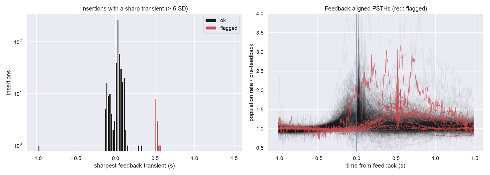

Between 2023-08-15 and 2023-10-20, every probe recorded on the `churchlandlab_ucla` rig with **SpikeGLX `20201103`** and
**base-station firmware `3.2.186`** has its spikes shifted on the session clock by whole 0.5 s sync half-periods.
That is 29 sessions and 51 probes, with no exceptions. Trials, wheel and video are correct; spike times are not.
The "viz" links open the trial viewer and are only given for insertions in the BWM 2023 release (13 pids).

## Affected insertions

::: {.column-page}

:::

One recording, MFD_07 2023-08-30 ([c8372676-0e5b-47dd-824b-08f841e5b572](https://alyx.internationalbrainlab.org/admin/actions/session/c8372676-0e5b-47dd-824b-08f841e5b572/change/)),
is also shifted but has no registered insertion. Download: [probe table](ucla_rig_probes.csv) · [session table](ucla_rig_sessions.csv).

## What it looks like

, from the IBL viz site. Population responses start ~0.55 s after stimulus onset and ~0.5 s after first movement, and the sharp feedback transient sits at +0.5 s instead of 0. The whole raster is late by one sync half-period.](figures/viz_92822789-608f-44a6-ad64-fe549402b2df_trial_event_plot.png)

The same signature shows up across the BWM release. The feedback (valve click) evokes a sharp population transient
that should sit at 0 s. A handful of insertions have it at about +0.5 s:

## Cause

All UCLA 2023 recordings used one PXIe base station (SN 21230842):

| period | SpikeGLX | BSC firmware | probes | shifted |
|---|---|---|---|---|
| 2023-06-01 → 2023-08-13 | `20201103` | `3.2.176` | 46 | 0 |
| 2023-08-14 → 2024-05-16 | `20230411` | `3.2.186` | 790 | 0 |
| **2023-08-15 → 2023-10-20** | **`20201103`** | **`3.2.186`** | **51** | **51** |

Installing SpikeGLX `20230411` flashed the base-station firmware to `3.2.186`. The MFD and MM012 experiments kept
running the old `20201103` install on that updated base station. With that combination, SpikeGLX opens the probe
file one or more sync fronts away from the nidq file. ibllib `version3B` pairs fronts by index from the start of
the file, so the sync passes QC with flat residuals while every spike is offset by k × 0.5 s. The
[main analysis](index.qmd) has the mechanism, the wheel validation and the census of all 3B probes.

## Fix

Re-run `version3B` on the existing `_spikeglx_sync.*` datasets, pairing fronts with the lag in the table
(+0.5 s ⇒ drop the first probe front). Then re-interpolate `spikes.times`. No re-sorting and no raw data are needed.

## Other BWM-release insertions

Besides the 13 above, 4 BWM-release insertions are shifted by the sporadic mechanism B, which is not rig-specific.
That makes 17 in total.

| session | probe | pid | shift (s) | wheel (s) | viz |
|---|---|---|---|---|---|
| ibl_witten_29/2021-06-14/003 | probe00 | [7d63ab43-95e4-41f5-bd43-c629578de7a9](https://alyx.internationalbrainlab.org/admin/experiments/probeinsertion/7d63ab43-95e4-41f5-bd43-c629578de7a9/change/) | −3.0 | −2.92 | [trials](https://viz.internationalbrainlab.org/app?spikesorting=ss_2024-05-06&dset=bwm&pid=7d63ab43-95e4-41f5-bd43-c629578de7a9&tid=0&cid=0&qc=0#trialviewer) |
| NYU-12/2020-01-21/001 | probe01 | [c893c0a3-5597-49cf-baa1-60efdfdef542](https://alyx.internationalbrainlab.org/admin/experiments/probeinsertion/c893c0a3-5597-49cf-baa1-60efdfdef542/change/) | −1.0 | −0.99 | [trials](https://viz.internationalbrainlab.org/app?spikesorting=ss_2024-05-06&dset=bwm&pid=c893c0a3-5597-49cf-baa1-60efdfdef542&tid=0&cid=0&qc=0#trialviewer) |
| UCLA034/2022-01-25/001 | probe00 | [f9d8aacd-b2a0-49f2-bd71-c2f5aadcfdd1](https://alyx.internationalbrainlab.org/admin/experiments/probeinsertion/f9d8aacd-b2a0-49f2-bd71-c2f5aadcfdd1/change/) | −1.0 | −0.96 | [trials](https://viz.internationalbrainlab.org/app?spikesorting=ss_2024-05-06&dset=bwm&pid=f9d8aacd-b2a0-49f2-bd71-c2f5aadcfdd1&tid=0&cid=0&qc=0#trialviewer) |
| SWC_039/2020-09-10/001 | probe00 | [39180bcb-13e5-46f9-89e1-8ea2cba22105](https://alyx.internationalbrainlab.org/admin/experiments/probeinsertion/39180bcb-13e5-46f9-89e1-8ea2cba22105/change/) | −1.0 | −1.07 | [trials](https://viz.internationalbrainlab.org/app?spikesorting=ss_2024-05-06&dset=bwm&pid=39180bcb-13e5-46f9-89e1-8ea2cba22105&tid=0&cid=0&qc=0#trialviewer) |
