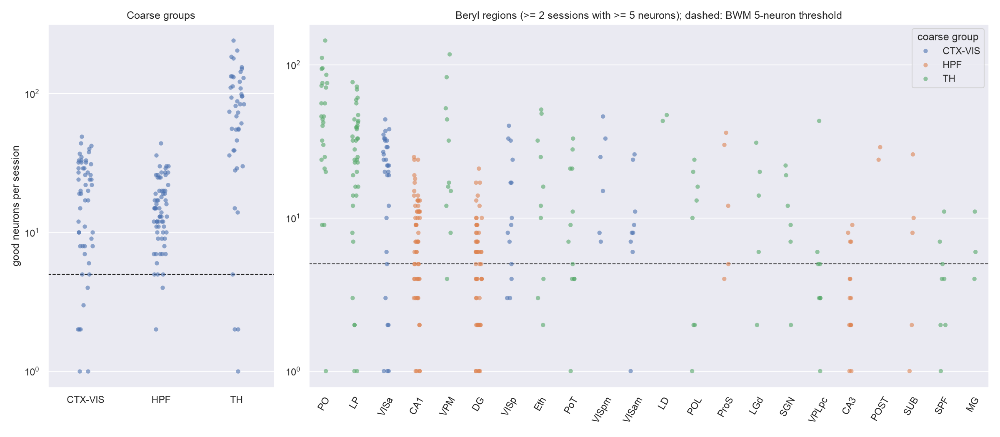
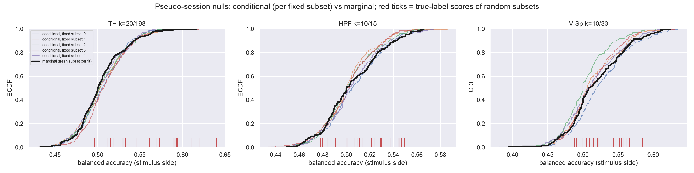
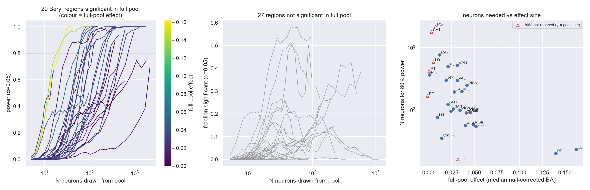
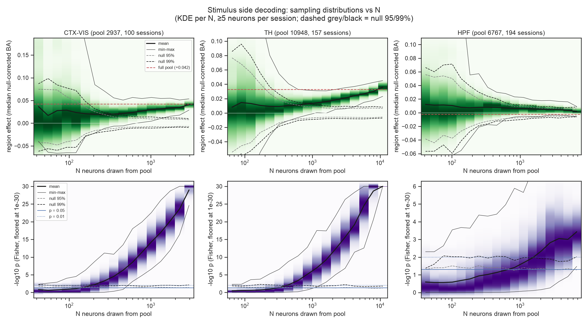
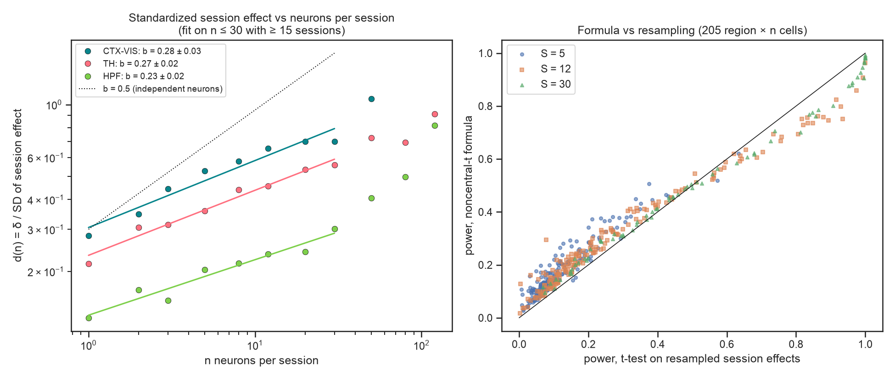
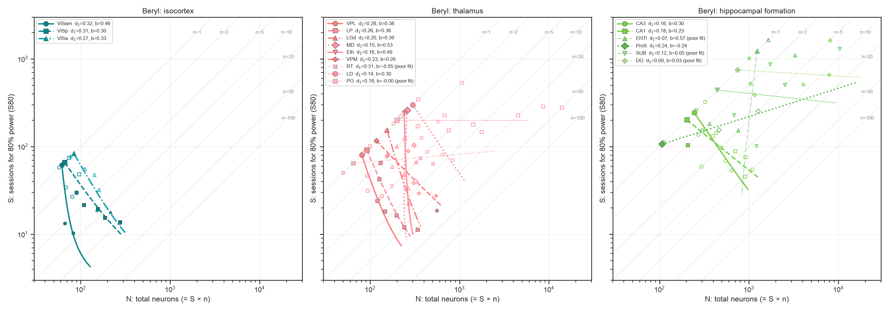
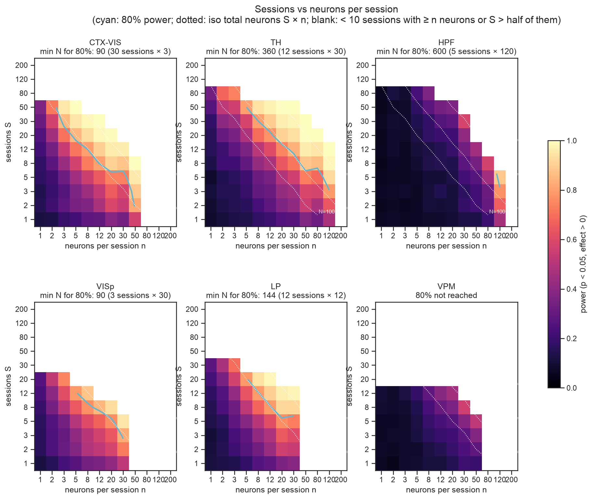
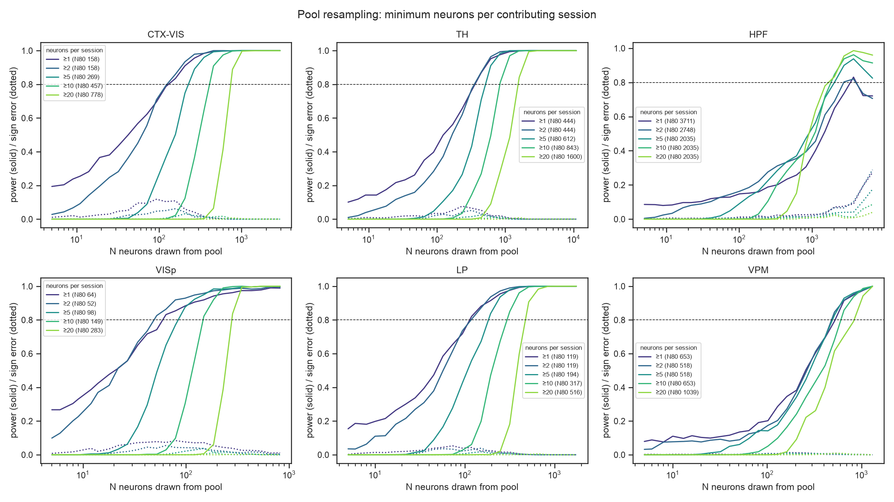
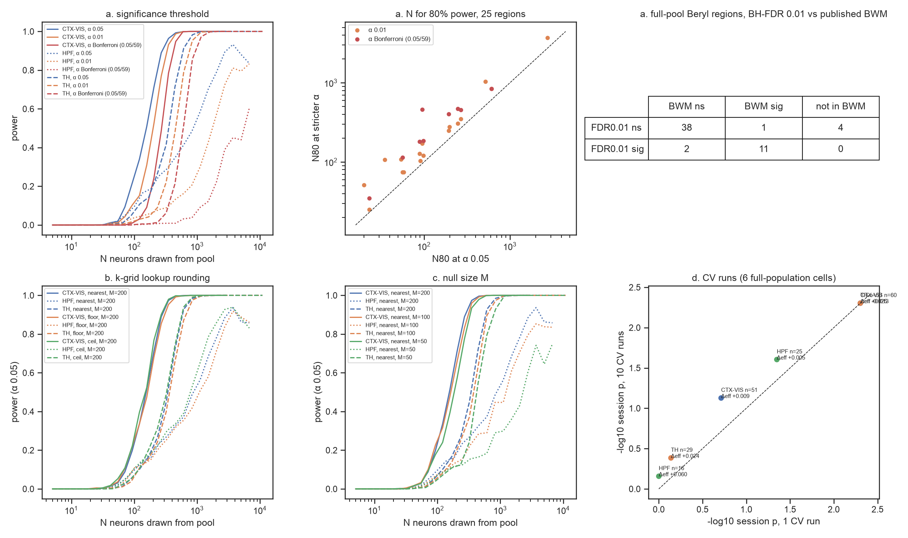
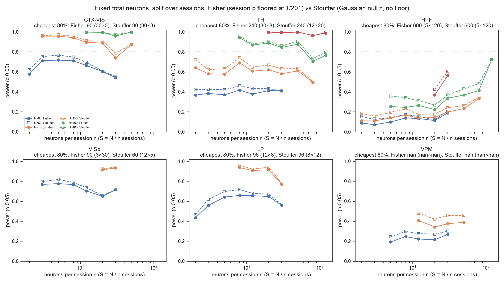

## Original question

Reproduce the Brain-Wide Map (BWM; IBL 2025) population decoding of stimulus side for visual/parietal cortex (CTX-VIS), hippocampus (HPF) and thalamus (TH), and run a Marek et al. (2022)-style power analysis with neurons as the sampling unit. How do power, effect-size inflation, sign errors and sampling variability depend on the number of neurons?

## Introduction

Marek et al. (2022) resampled large human cohorts. They showed that brain-wide association studies (BWAS) have small effects, which makes them underpowered at typical sample sizes, inflates significant estimates and lets them flip sign. The BWM decodes stimulus side with similarly small effects: null-corrected balanced accuracy is 0.01–0.05 in most significant regions. A Marek-style resampling of the BWM therefore looked like a natural way to ask how many neurons a region-level decoding claim needs.

None of the qualitative phenomena is new. For a test of an effect with standardized size *d*, power, the inflation of significant estimates (type M error) and sign errors (type S error) are textbook functions of *d* and the sample size (Button et al. 2013; Gelman & Carlin 2014). Marek's own n ≈ 2,200 for 80% power at r = 0.06 is the Fisher-z formula. The useful output of such a study is therefore not the phenomena but the **parameters** of a standard planning model. Here the model is a two-level design: sessions are the clusters, trials are the replicates and neurons are features that set the effect size (Raudenbush & Liu 2000; Baker et al. 2021). This report estimates those parameters from the BWM.

## Refinement of the question

The Marek-style analysis of Beryl regions (@fig-marek-beryl) reproduces the expected picture. Below about 100 neurons, single draws of the region effect range up to 0.1–0.3, against full-pool values of 0.01–0.03, and the null band is as wide. Two features do not fit the BWAS analogy and motivated the revision:

1. **The estimand moves with N.** The mean effect drifts as more neurons are drawn (VPM 0.01 → 0.03, LGd 0.08 → 0.02). Adding neurons changes what each session's decoder measures. It does not only reduce the variance around a fixed value.
2. **Significance keeps growing where the effect does not.** The Fisher −log10 p rises steadily with N in every region. In CA1 (full-pool effect +0.003) it crosses p = 0.05 at a few hundred neurons.

Both point to the session, not the neuron, as the unit of replication. Neurons enter only through the per-session effect. In Marek's own taxonomy, trial-level decoding within a session is a "within-person, induced-effect" design, not a BWAS.

{#fig-marek-beryl}

**Revised question.** For BWM stimulus-side decoding, what are the parameters of the two-level planning model? How far are sessions and neurons from interchangeable? Does the BWM region test answer "does the typical session decode"?

## Analysis plan

This is a descriptive study on all QC-passing BWM sessions, with no confirmatory split (user decision). All quantities come from a precomputed grid of decodes: for each session, region and number of neurons k, 20 true-label and 200 pseudo-session decodes, each on a random k-subset (Methods).

**Model.** For n neurons per session, the session effect (one decode minus the median pseudo-session decode) is

$$e_s = \delta(n) + u_s + \varepsilon_s,\quad u_s \sim \mathcal N(0,\tau^2),\quad \varepsilon_s \sim \mathcal N(0,\sigma_\text{trial}^2 + \sigma_\text{neuron}^2)$$

| Symbol | Meaning | Estimated from |
|---|---|---|
| S, n, N = S·n | sessions, neurons per session, total neurons | design |
| T | trials per session | data (median 348) |
| δ(n) | mean session effect (null-corrected balanced accuracy) | mean of e_s |
| σ_trial | finite-trial decoder noise | pseudo-session null SD |
| σ_neuron | variation with *which* n neurons are recorded | SD over random n-subsets of a session |
| τ | true between-session differences | residual between-session variance |
| d(n) | standardized session effect δ / √(τ² + σ²_neuron + σ²_trial) | |
| d₁, b | fit d(n) = d₁·nᵇ; b = 0.5 if neurons carried independent information | log-log regression, n ≤ 30 |
| S80 | sessions for 80% power, one-sided one-sample t-test of mean e_s > 0, α = 0.05 | noncentral t |

Power is 1 − F_nct(t₀.₉₅,S−1; S−1, d√S), or approximately S80 ≈ 6.2/d² + 2. If b = 0.5, power depends on N = S·n only, so sessions and neurons are interchangeable. If b < 0.5, extra neurons within a session give diminishing returns.

## Results

**Parameters.** Trial noise scales as σ_trial ≈ 0.59/√T (fitted exponent −0.43, r = −0.70, 1,647 session–regions; the binomial floor is 0.5/√T), which is 0.031 at the median T. With few neurons per session, the differences between sessions are fully explained by trial noise and by which neurons were sampled: τ ≈ 0 up to n = 2 in CTX-VIS, n = 8 in TH and n = 20 in HPF. Beyond that, τ grows with the signal and reaches about twice σ_trial at n = 20 in CTX-VIS.

| Group | n | δ | σ_trial | σ_neuron | τ | **d** | d₁ | b (± SE) | S80 at n = 5 / 20 |
|---|---|---|---|---|---|---|---|---|---|
| CTX-VIS | 5 / 20 | 0.033 / 0.062 | 0.031 / 0.034 | 0.042 / 0.039 | 0.036 / 0.071 | **0.53 / 0.70** | 0.31 | 0.28 ± 0.03 | 28 / 14 |
| TH | 5 / 20 | 0.017 / 0.035 | 0.031 / 0.033 | 0.040 / 0.042 | 0 / 0.037 | **0.36 / 0.54** | 0.23 | 0.27 ± 0.02 | 49 / 24 |
| HPF | 5 / 20 | 0.008 / 0.010 | 0.030 / 0.033 | 0.030 / 0.030 | 0 / 0 | **0.20 / 0.24** | 0.13 | 0.23 ± 0.02 | 172 / 91 |

The formula reproduces the power of t-tests on resampled session effects within 0.03 (median absolute difference at S = 30) to 0.05 (S = 5). Near 80% power it is slightly conservative (@fig-model-check).

**Sessions and neurons are not interchangeable.** All three groups have b ≈ 0.25, about half the independent-neuron value of 0.5 (median 0.33 over 13 well-fitted Beryl regions). Each curve in @fig-s80 therefore slopes between vertical (interchangeable) and horizontal (neurons useless). Going from 1 to 20 neurons per session cuts the sessions needed about fivefold but quadruples the total number of neurons. The three groups follow parallel curves, so region identity enters mostly through d₁. HPF needs about six times more sessions than CTX-VIS at every n. Among Beryl regions, PO, SUB and DG show b ≈ 0: only sessions help (@fig-s80-beryl).

{#fig-s80}

**The BWM region test is a test of "any session".** Fisher combination of session p-values tests the global null that no session decodes, so a few strong sessions can make a region significant (Heard & Rubin-Delanchy 2018). A one-sided t-test on session effects (random effects; Hedges & Vevea 1998) tests whether the mean session decodes. At full pool, the coarse groups pass both tests. Of 41 Beryl regions with at least 5 sessions, 12 pass Fisher at BH q < 0.01 against 6 for the t-test (and 6 for Wilcoxon). Seven are Fisher-only: Eth, LGd, LGv, MG, VISl, VISli and VM, with 5–22 sessions each. For six of them the median session effect is 0.024–0.052, so the t-test simply lacks power with few sessions. **Eth** (median +0.0004) and **HPF** are the cases where the typical session does not decode. HPF passes Fisher (p = 5 × 10⁻⁴) and the t-test (p = 7 × 10⁻⁴, mean +0.012), but not Wilcoxon (p = 0.06, median −0.002): a minority of strong sessions sets the mean (@fig-fisher).

{#fig-fisher}

**The pipeline reproduces the BWM.** Full-pool region scores match the published `stim_dec` values (52 Beryl regions; Spearman 0.88, Pearson 0.81, median difference −0.003; @fig-power top left). The null that pools random neuron subsets is valid (KS p > 0.19 against per-subset nulls; @fig-null).

## Discussion

**Relation to prior work.** The calculation is standard. It is the power of a multisite or cluster design (Raudenbush & Liu 2000), and the trade-off between sessions and neurons is a "power contour" (Baker et al. 2021). Inflation and sign errors at small N are type M/S errors (Gelman & Carlin 2014). The sublinear growth of decoding with neurons is the neuron-dropping curve (Wessberg et al. 2000), consistent with information-limiting correlations (Moreno-Bote et al. 2014). Ooi et al. (2025) found the analogous trade-off between scan time and participants in BWAS. What this study adds is the BWM-specific values of d₁, b, τ and σ_trial, which can be reused for planning. The "thousands of neurons" of the pool-resampling analysis (supplementary @fig-power) is mostly an artefact of drawing neurons uniformly across about 100–200 sessions. In session units, the requirements are moderate. This sits closer to Spisak et al. (2023), who argued that cross-validated multivariate effects replicate at moderate sample sizes, than to Marek's headline.

**For planning.** Sessions, not neurons, are the cost unit: a probe yields tens of neurons per region at little extra cost. The relevant rule is S80 ≈ 6.2/(d₁² n^{2b}) + 2 at the n a probe actually delivers. More trials help only where τ and σ_neuron are small. At n = 20 in CTX-VIS, trial noise is 15% of the session variance, so doubling T saves about 7% of sessions. In HPF at n = 5 it is about 60%, so doubling T saves about 30%.

**Caveats.**

- The parameters are estimated on the data that made these regions BWM-significant, so they are optimistic for marginal regions, much like observed power (Hoenig & Heisey 2001). With about 100 sessions, the SE of d is about 0.1. For example, CTX-VIS at n = 5 gives S80 in roughly 18–35. Use the lower bound of d for planning.
- Cells with large n use only sessions with many neurons in the region, a selected subset. The fits are therefore restricted to n ≤ 30 and at least 15 sessions.
- Effects are heavy-tailed. The noncentral-t formula is optimistic by about 0.06 at S = 5, and mean and median disagree in HPF. Heterogeneity in visual regions plausibly reflects receptive-field placement relative to the stimulus.
- The study covers stimulus side only, with one CV run per decode; 10 runs shrink σ_trial by 15–25% (@fig-sens).

**Lessons for AI-assisted analysis.**

- Write the analytic textbook model before running a resampling study, and use the resampling to estimate and check its parameters.
- Match the resampled unit to the unit of replication: sessions, not neurons.
- Check what null an inherited statistic tests (here, Fisher combination) before using it as a power target.
- Validate against published numbers early, applying the paper's inclusion rule.

## Statistical information

| Test | Figure | Comparison | Statistic | df / n | p | Effect size |
|---|---|---|---|---|---|---|
| Spearman / Pearson correlation | @fig-power | full-pool region scores vs published BWM `stim_dec` | ρ = 0.88; r = 0.81 | 52 regions | — | median difference −0.003 |
| Pseudo-session permutation test (one-sided) | all | session true score vs 200 pseudo-session decodes | rank | M = 200 | ≥ 1/201 | null-corrected balanced accuracy |
| Fisher's combined probability (χ²) | @fig-fisher | coarse groups, full pool | χ² | 2S (S = 100 / 157 / 194) | CTX-VIS 5 × 10⁻³⁰; TH 1 × 10⁻³⁷; HPF 5 × 10⁻⁴ | median +0.042 / +0.033 / −0.002 |
| One-sample t-test (one-sided) | @fig-fisher | coarse groups, mean session effect > 0 | t | S − 1 | CTX-VIS 3 × 10⁻¹¹; TH 2 × 10⁻¹⁵; HPF 7 × 10⁻⁴ | mean +0.064 / +0.052 / +0.012 |
| Wilcoxon signed-rank (one-sided) | @fig-fisher | coarse groups, session effects > 0 | W | S | CTX-VIS 7 × 10⁻¹¹; TH 1 × 10⁻¹⁵; HPF 0.06 | — |
| Benjamini–Hochberg FDR | @fig-fisher | 41 Beryl regions (≥ 5 sessions), q = 0.01 | — | 41 | — | Fisher 12, t-test 6, Wilcoxon 6 significant |
| Log-log linear regression | @fig-s80, @fig-model-check | d(n) = d₁ nᵇ, n ≤ 30 | slope b | 5–8 n values | — | b: CTX-VIS 0.28 ± 0.03, TH 0.27 ± 0.02, HPF 0.23 ± 0.02 |
| Log-log linear regression | — | σ_trial vs trials T | slope −0.43 | 1,647 | — | r = −0.70 |
| Noncentral t power vs resampled t-test power | @fig-model-check | 205 region × n cells, S = 5 / 12 / 30 | power difference | — | — | median abs. diff. 0.05 / 0.04 / 0.03 |
| Two-sample Kolmogorov–Smirnov | @fig-null | subset-marginal vs per-subset null (3 cells) | D | 200 vs 200 | > 0.19 | — |

## References

- Baker D. H. et al. (2021). Power contours: optimising sample size and precision in experimental psychology and human neuroscience. *Psychological Methods* 26, 295–314.
- Button K. S. et al. (2013). Power failure: why small sample size undermines the reliability of neuroscience. *Nat. Rev. Neurosci.* 14, 365–376. <https://doi.org/10.1038/nrn3475>
- Gelman A. & Carlin J. (2014). Beyond power calculations: assessing type S (sign) and type M (magnitude) errors. *Perspect. Psychol. Sci.* 9, 641–651. <https://doi.org/10.1177/1745691614551642>
- Heard N. A. & Rubin-Delanchy P. (2018). Choosing between methods of combining p-values. *Biometrika* 105, 239–246.
- Hedges L. V. & Vevea J. L. (1998). Fixed- and random-effects models in meta-analysis. *Psychological Methods* 3, 486–504.
- Hoenig J. M. & Heisey D. M. (2001). The abuse of power: the pervasive fallacy of power calculations for data analysis. *Am. Stat.* 55, 19–24.
- International Brain Laboratory et al. (2025). A brain-wide map of neural activity during complex behaviour. *Nature* 645, 177–191. <https://doi.org/10.1038/s41586-025-09235-0>
- Marek S. et al. (2022). Reproducible brain-wide association studies require thousands of individuals. *Nature* 603, 654–660. <https://doi.org/10.1038/s41586-022-04492-9>
- Moreno-Bote R. et al. (2014). Information-limiting correlations. *Nat. Neurosci.* 17, 1410–1417. <https://doi.org/10.1038/nn.3807>
- Ooi L. Q. R. et al. (2025). Longer scans boost prediction and cut costs in brain-wide association studies. *Nature* 644, 731–740. <https://doi.org/10.1038/s41586-025-09250-1>
- Raudenbush S. W. & Liu X. (2000). Statistical power and optimal design for multisite randomized trials. *Psychological Methods* 5, 199–213.
- Spisak T., Bingel U. & Wager T. D. (2023). Multivariate BWAS can be replicable with moderate sample sizes. *Nature* 615, E4–E7. <https://doi.org/10.1038/s41586-023-05745-x>
- Wessberg J. et al. (2000). Real-time prediction of hand trajectory by ensembles of cortical neurons in primates. *Nature* 408, 361–365.

## Supplementary material

### Methods

**Data.** BWM ephys dataset version 1.2.1, good units of QC-passing insertions, BWM trial mask. Fourteen insertions were excluded for a spike-timing offset (separate report). The repeated-site insertions alone gave too few neurons, so the pool covers all BWM sessions: 2,937 CTX-VIS, 6,767 HPF and 10,948 TH neurons over 278 sessions (@fig-counts). CTX-VIS is Allen VIS plus PTLp. Beryl regions are included with at least 2 sessions of at least 5 neurons (BWM rule).

**Decoder (BWM).** Stimulus side is decoded from spike counts 0–100 ms after stimulus onset. The decoder is L1 logistic regression (scikit-learn, liblinear, class-balanced, C ∈ {10⁻⁵ … 10¹}) with nested 5×5 cross-validation and one CV run (BWM: ten), scored by balanced accuracy. The session p-value is the rank of the true score among M = 200 pseudo-session decodes (`brainbox.task.closed_loop.generate_pseudo_session`). Probes of a session are pooled. The region p-value is the one-sided Fisher combination; the region effect is the median over sessions of the true score minus the median null score.

**Decoding grid.** For each (session, region) and k on a 12-point log scale up to all neurons, 20 true-label and 200 pseudo-session decodes were run, each on a fresh random k-subset. That is 12,615 cells and 2.8 M decodes (10.5 h on 48 cores). All resampling is a lookup at the nearest k.

**Planning model (011).** For each region and n ∈ {1, 2, 3, 5, …, 120}, sessions with at least n neurons are used (at least 10 sessions required). Variance components come from the 20 true decodes (σ_neuron), the null SD (σ_trial) and the variance of session means (τ² = Var(session means) − σ²_trial − σ²_neuron/20, floored at 0). d₁ and b are fitted on cells with n ≤ 30 and at least 15 sessions. The validation draws S sessions without replacement and one decode each (2,000 draws) and runs a one-sided t-test.

**Marek-style resampling (006–010).** N neurons are drawn without replacement from the region pool (multivariate hypergeometric over sessions, R = 1,000 draws for each of 25 log-spaced N). Sessions with at least 5 drawn neurons contribute. *Power* is the fraction of draws significant at p < 0.05 with a positive effect; *sign error* is significant with an effect ≤ 0; *inflation* is the median effect of significant draws relative to the full pool and to all draws at the same N.

### Supplementary figures

{#fig-counts}

{#fig-null}

{#fig-power}

{#fig-beryl}

{#fig-marek}

{#fig-model-check}

{#fig-s80-beryl}

{#fig-design}

{#fig-kmin}

{#fig-sens}

{#fig-stouffer}
