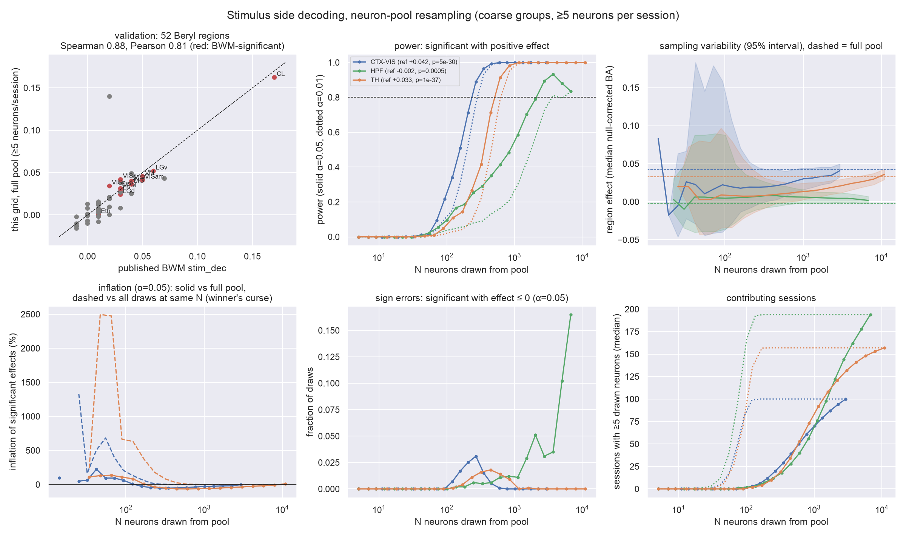
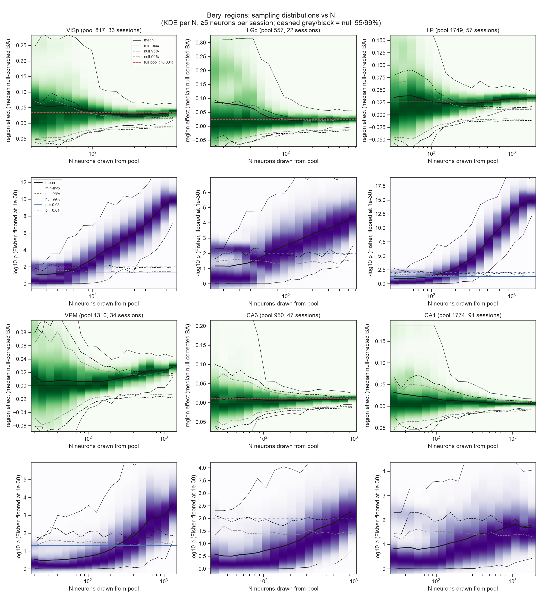

## Original question

Reproduce the Brain-Wide Map (BWM, IBL 2025) population-decoding analysis for visual/parietal cortex, hippocampus and thalamus, and run a Marek et al. (2022)-style power analysis in which the sample is the number of neurons, bootstrapped from the neuron pool of each coarse region (CTX-VIS, HPF, TH) and of each Beryl region: how do detection power, effect-size inflation, sign errors and sampling variability depend on the number of neurons, up to the thousands?

## Introduction

Marek et al. (2022) showed that brain-wide association studies (BWAS) in humans have tiny effects (median |r| = 0.01, top 1% |r| > 0.06), so that at typical sample sizes (n ≈ 25) they are underpowered, significant effects are inflated, and two samples can disagree in sign; reproducibility required thousands of participants. The BWM paper decodes task variables from neural populations of each brain region with weak effects too: the stimulus side decoded from the first 100 ms after stimulus onset reaches a null-corrected balanced accuracy of 0.01–0.05 in most significant regions. Here the "participant" is a neuron: we ask how many recorded neurons a region-level decoding claim needs.

## Refinement of the question

**Data.** BWM ephys dataset (good units, QC-passing insertions), stimulus side only (choice, feedback and wheel were dropped). The repeated-site insertions alone gave too few neurons (hundreds per group), so the pool was extended to all BWM sessions, giving 2,937 CTX-VIS, 6,767 HPF and 10,948 TH neurons over 278 sessions (@fig-counts).

{#fig-counts}

**Decoder and statistics (BWM).** Each session decodes the stimulus side from spike counts in the 0–100 ms window after stimulus onset. The decoder is L1 logistic regression with nested 5×5 cross-validation (one CV run instead of ten), scored by balanced accuracy. The session p-value is the rank of the true score among M = 200 pseudo-session decodes. The region p-value is the Fisher combination over sessions (one-sided). The region effect is the median over sessions of the true score minus the median null score. Probes of a session are pooled.

**Resampling design.** N neurons are drawn without replacement from the region pool; each session decodes its own drawn subset, and sessions with at least 5 drawn neurons (the BWM rule) contribute. To make thousands of draws affordable, we precomputed a (session × region × k) grid on a cluster: k on a 12-point log scale up to all neurons, with 20 true-label decodes and 200 pseudo-session decodes per cell, each on a fresh random k-subset (2.8 M decodes, 10.5 h on 48 cores). The bootstrap is then a lookup. Using a null that also resamples the subset was validated against a per-subset null (@fig-null).

{#fig-null}

**Metrics (Marek definitions).** The reference is the full pool. *Power*: fraction of draws significant (p < 0.05) with a positive effect. *Sign error*: significant with an effect ≤ 0. *Inflation*: median effect of significant draws relative to the full-pool effect, and relative to the median of all draws at the same N (winner's curse). *Sampling variability*: distribution of the effect across draws.

**Revised question.** For stimulus-side decoding with the BWM pipeline, how many neurons (and in what arrangement over sessions) are needed for 80% power, and how inflated and variable are region-level effects below that?

## Analysis plan

No confirmatory split was made (user decision). This is a descriptive power study on all QC-passing sessions. The reference definition, region statistics (Fisher p and median effect) and the minimum of 5 neurons per session for displays were fixed before computing the power curves. The minimum neurons per session was then explored as a design parameter.

## Results

**The full-pool analysis reproduces the BWM paper.** Null-corrected region scores match the published `stim_dec` values (52 Beryl regions; Spearman 0.88, Pearson 0.81, median difference −0.003; @fig-power, top left).

{#fig-power}

**Power needs hundreds to thousands of neurons.**

| Group | Full-pool effect | N for 80% power (α 0.05 / 0.01) | Contributing sessions at N80 |
|---|---|---|---|
| CTX-VIS | +0.042 | 269 / 351 | ~15 |
| TH | +0.033 | 612 / 843 | ~45 |
| HPF | −0.002 (Fisher p < 0.001) | ~2,000–2,700 / 3,700 | ~120 |

Across the 22 Beryl regions that reach 80% power, the median N80 is 100 neurons, ranging from 20 (PF, CL) to 760 (CA3; @fig-beryl). Regions with large effects need few neurons. CA1 and PO are significant in the full pool but never reach 80%.

{#fig-beryl}

**Sampling variability and inflation mirror Marek Fig. 1e–f.** Below about 150 neurons, single draws range up to 0.10–0.30 in region effect, against full-pool values of 0.02–0.04, and the null band is as wide (@fig-marek, @fig-marek-beryl). Significant draws at N < 200 overstate the typical effect at the same N by 2–25× (the winner’s curse). The calibrated test (null 95/99% bands at p ≈ 0.05/0.01 for every N) separates from the null well before the effect distribution does. Unlike Marek's correlations, the effect is not a fixed quantity. Its mean grows with N because each session decodes more neurons, so the full-pool effect is itself an N-dependent target.

{#fig-marek}

{#fig-marek-beryl}

**Splitting neurons over more sessions helps in cortex, not everywhere.** At a fixed total, power peaks at 3–8 neurons per session in CTX-VIS, VISp and LP (@fig-design, @fig-stouffer). CTX-VIS reaches 80% with 90 neurons as 30 sessions × 3, versus 269 under the ≥5-per-session pool rule. Power is flat in TH and rises with neurons per session in HPF, where large-n designs can only use the few sessions with many HPF neurons (a selected subset). In pool resampling, requiring more neurons per session raises N80 two- to fivefold, mostly because fewer sessions contribute (@fig-kmin). One or two neurons per session cost power and raise sign errors (up to ~10% at ≥1 neuron).

{#fig-design}

{#fig-kmin}

## Post-hoc analyses: sensitivity

The conclusions are robust; the N80 values are, if anything, conservative (@fig-sens).

- **Significance threshold.** α = 0.01 multiplies N80 by about 1.3. Bonferroni over 59 regions (α ≈ 8.5 × 10⁻⁴) multiplies it by 1.4–2.1, and HPF and VPM never reach 80%. This is the same direction as Marek's ×4 from p < 0.05 to p < 10⁻⁷. With BH-FDR 0.01 across the 56 Beryl regions, the full pool recovers 11 of the 12 BWM-significant regions (the miss is Eth, effect ≈ 0) and adds PF and VISli.
- **k-grid lookup.** Rounding drawn counts down or up instead of to the nearest grid point changes N80 by at most one step of the N grid (for example LP 194 vs 248).
- **Null size.** With M = 100 instead of 200, N80 is unchanged except for LP and HPF (one grid step). M = 50 costs one grid step everywhere. Because p cannot go below 1/(M+1), 23–27% of full-population sessions in strong regions sit at that floor. This compresses Fisher p at large N but does not affect N80.
- **CV runs.** Averaging 10 CV runs (as in the BWM paper) shrinks the null SD by 15–25% and lowers session p-values for intermediate effects (for example 0.19 → 0.07 and 0.045 → 0.025) on 6 full-population cells. Our single-run power curves are therefore a lower bound; N80 with 10 runs would be somewhat smaller.
- **Session p floor.** Fisher session p-values cannot go below 1/201, which caps each session's contribution and could favour many small sessions. Replacing Fisher with Stouffer's z on a Gaussian fit to each session's null (no floor) raises power by 0–0.1 throughout but leaves the dependence on neurons per session and the cheapest 80% designs unchanged (CTX-VIS 90, TH 240, LP 96, HPF 600 neurons; VISp 60 vs 90; @fig-stouffer). At most 10% of design-map sessions sit at the floor.
- **Monte Carlo noise.** Repeated runs move HPF's N80 between about 2,000 and 2,700 (adjacent grid points), because its power curve is shallow.

{#fig-sens}

{#fig-stouffer}

## Discussion

| | Marek et al. 2022 (BWAS) | This study (BWM decoding) |
|---|---|---|
| Sampling unit | participant | neuron (grouped in sessions) |
| Effect size | correlation r: median 0.01, top 1% > 0.06 | null-corrected balanced accuracy: median 0.035 in significant regions |
| N for 80% power, p < 0.05 | ~2,200 (top 1% effects) | 20–760 per Beryl region; 270 CTX-VIS, 610 TH, 2,000–2,700 HPF |
| Stricter threshold | Bonferroni: ~9,500 | α 0.01: ×1.3; Bonferroni: ×1.4–2.1 (HPF, VPM never reach 80%) |
| Small-sample variability | n = 25: 99% CI r ± 0.52 | N < 150: effect range up to 0.3 for true ≈ 0.03 |
| Inflation of significant effects | ≥100% for half at n = 1,000 | 2–25× winner’s curse below 200 neurons; ≥100% vs full pool for 2/3 of significant CTX-VIS draws at N = 42 |
| Design trade-off | scan time vs participants (Ooi et al. 2025): accuracy grows with total scan time up to ~20 min per participant, then sample size matters more | neurons per session vs sessions: 3–8 per session best in CTX-VIS, VISp, LP; flat in TH |
| Sign errors | rise with lenient thresholds | ≤3% (CTX-VIS, TH); up to 17% in HPF (Fisher vs median disagreement) |

The parallel holds qualitatively. Region-level decoding effects are small, small samples give wildly variable and inflated estimates, and significance requires hundreds to thousands of neurons. Most published BWM regions sit near the edge: at the BWM inclusion rule, a typical region has 100–1,000 neurons, around its N80. One difference matters: the effect size grows with the number of neurons per session, so "the" effect of a region is defined only for a recording design. The design trade-off itself has a BWAS counterpart. Ooi et al. (2025) found that scan time per participant and number of participants are interchangeable up to about 20 minutes, beyond which participants matter more. Here, neurons per session play the role of scan time and sessions the role of participants: in cortex and LP a few neurons in many sessions give the most power per neuron. The likely reason is the same in both cases. Each new session (participant) brings independent trials and its own noise, while extra neurons (scan time) within a session give diminishing returns because they share its trials and correlated noise. This is not an artefact of the session p-value floor (@fig-stouffer).

**Caveats.**

- Stimulus side only; one CV run per decode.
- Lookup at the nearest of 12 k values per session.
- Large-n design cells select sessions with many neurons.
- Fisher combination is sensitive to a few strong sessions, which makes HPF "significant" with a negative median effect.
- The full pool is a reference, not a ground truth.

**Lessons for AI-assisted analysis.**

- Validate against published numbers early, applying the paper's inclusion rule.
- When an expensive estimator must be resampled, precomputing a grid and bootstrapping by lookup makes a Marek-style analysis tractable.

## Statistical information

| Test | Figure | Comparison | Statistic | df / n | p | Effect size |
|---|---|---|---|---|---|---|
| Spearman / Pearson correlation | @fig-power (top left) | full-pool region scores vs published BWM `stim_dec` | ρ = 0.88; r = 0.81 | 52 regions | — | median difference −0.003 |
| Pseudo-session permutation test (one-sided) | all | session true score vs 200 pseudo-session decodes | rank | M = 200 | ≥ 1/201 | null-corrected balanced accuracy |
| Fisher's combined probability (χ²) | @fig-power | CTX-VIS full pool | χ² | 200 (100 sessions) | 5 × 10⁻³⁰ | +0.042 |
| Fisher's combined probability (χ²) | @fig-power | TH full pool | χ² | 314 (157 sessions) | 1 × 10⁻³⁷ | +0.033 |
| Fisher's combined probability (χ²) | @fig-power | HPF full pool | χ² | 388 (194 sessions) | 5 × 10⁻⁴ | −0.002 |
| Two-sample Kolmogorov–Smirnov | @fig-null | subset-marginal vs pooled per-subset null (3 cells) | D | 200 vs 200 | > 0.19 | — |
| One-way ANOVA | @fig-null | null mean across fixed subsets (VISp cell) | F | 10 subsets | 1 × 10⁻⁶ | spread 0.008 vs null SD 0.041 |
| Benjamini–Hochberg FDR | @fig-sens a | 56 Beryl full-pool p-values, q = 0.01 | — | 56 | — | 13 significant (11 of 12 BWM-significant) |
| Stouffer's combined z | @fig-stouffer | design map, session z vs Gaussian null fit (no p floor) | Σz / √S | S sessions, R = 1,000 | — | power vs Fisher: +0–0.1 |
| Bootstrap (multivariate hypergeometric) | @fig-power–@fig-sens | power, inflation, sign errors vs N | — | R = 1,000 per N | — | N80 (table in Results) |

## Data and methods

BWM ephys dataset version 1.2.1 (good units, QC-passing insertions; 14 insertions excluded for a spike timing offset, see separate report). Published region scores are from the BWM paper repository (`region_info.csv`). Decoder: scikit-learn `LogisticRegression` (L1, liblinear, class-balanced), C ∈ {10⁻⁵ … 10¹}. Pseudo-sessions: `brainbox.task.closed_loop.generate_pseudo_session`. Bootstrap: R = 1,000 draws per N, 25 log-spaced N per region.

## References

- International Brain Laboratory et al. (2025). A brain-wide map of neural activity during complex behaviour. *Nature* 645, 177–191. <https://doi.org/10.1038/s41586-025-09235-0>
- Marek S. et al. (2022). Reproducible brain-wide association studies require thousands of individuals. *Nature* 603, 654–660. <https://doi.org/10.1038/s41586-022-04492-9>
- Ooi L. Q. R. et al. (2025). Longer scans boost prediction and cut costs in brain-wide association studies. *Nature* 644, 731–740. <https://doi.org/10.1038/s41586-025-09250-1>
